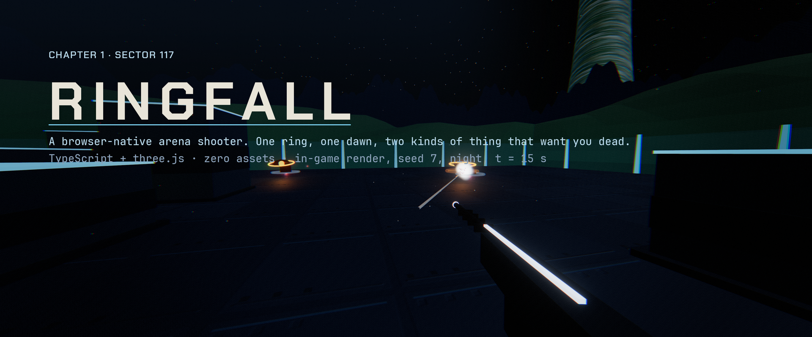
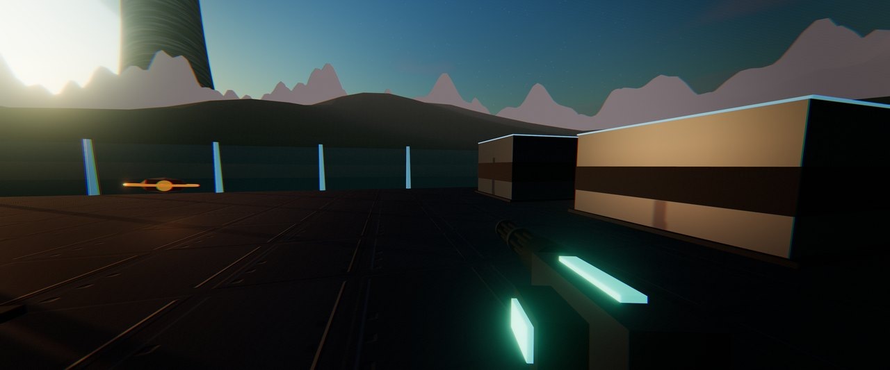
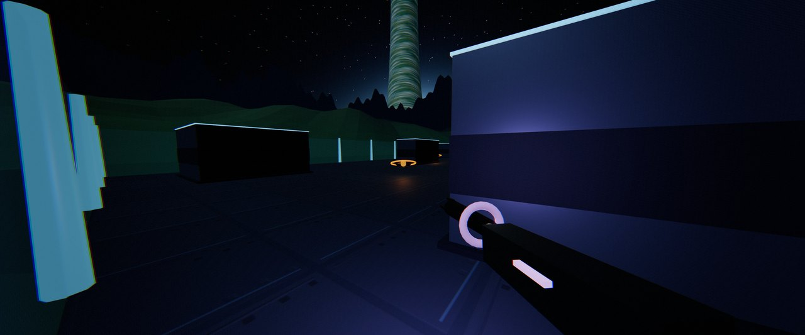
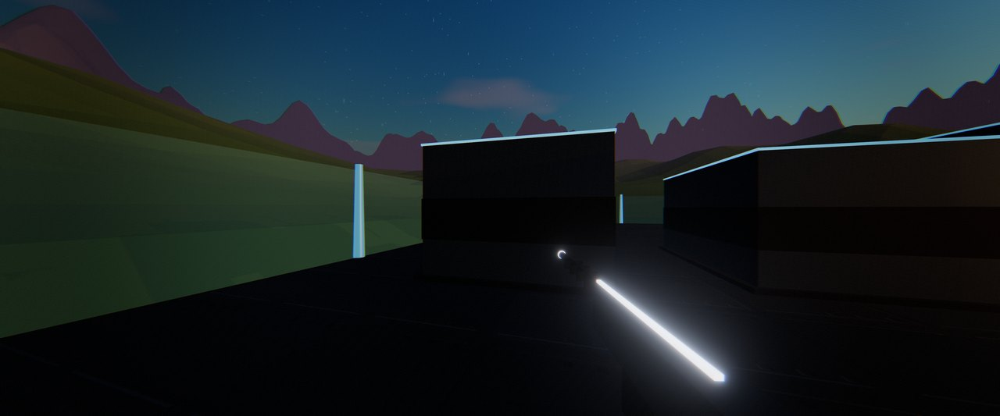
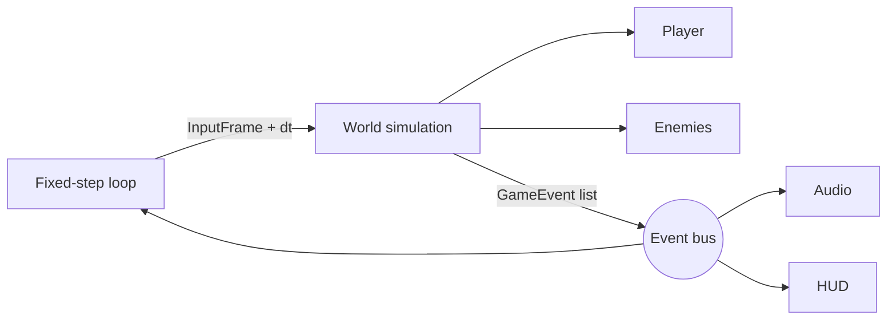

<p align="center"></p>

# Ringfall

A browser-native arena shooter. One ring, one dawn, two kinds of thing that
want you dead. TypeScript + three.js, zero assets.

<p align="center"><sub>The banner is the game itself: seed 7 at night, t = 10 s, 3840x1600 with the post stack on. Recipe in <a href="docs/brand.md#hero-and-social">docs/brand.md</a>.</sub></p>

**[Play now](https://ringfall.alexhowells.com)** (deploys from `main`; `agh.github.io/ringfall` until DNS is set).

Ringfall takes its cues from the classic console sci-fi shooter loop: a
regenerating energy shield over fixed health, a two-second rhythm of fire,
cover, recharge, and grenades that bounce before they go off. It is an
original work. No names, assets, audio, or lore from any commercial franchise
are used.

## Play

The `main` branch deploys to GitHub Pages on every push. Locally:

```bash
pnpm install --frozen-lockfile
pnpm dev            # http://localhost:5173
```

| Action         | Input              |
| -------------- | ------------------ |
| Move           | W A S D            |
| Look           | Mouse              |
| Fire           | Left click         |
| Grenade        | G or right click   |
| Reload         | R                  |
| Swap weapon    | Q or wheel         |
| Jump / Sprint  | Space / Shift      |
| Fullscreen     | F                  |
| Release mouse  | Esc                |

Requires a browser with WebGL 2 and pointer lock.

| Dawn, wave 5 | Night, wave 2 | Dusk, wave 3 |
| :---: | :---: | :---: |
|  |  |  |
| seed 7, t = 95 s, `atmo=dawn` | seed 7, t = 18 s, `atmo=night` | seed 7, t = 45 s, `atmo=dusk` |

Every frame above is a headless render of the shipped build (`?record&bot&seed=7&nohud`), not an illustration.

## How it works

The simulation is a pure function over immutable state. `stepGame` in
`src/core/game.ts` takes the current state, one frame of input, a fixed
timestep, and a seeded random source, and returns the next state plus the
events that happened during the step. Everything else reacts to those events:

- `src/render/` mirrors the state into a three.js scene and plays effects
- `src/hud/` draws vitals, ammo, wave status, and a motion tracker in the DOM
- `src/audio/` synthesizes every sound with WebAudio oscillators
- `src/input/` turns keyboard, mouse, and pointer lock into an `InputFrame`



Because `src/core/` never touches the DOM or WebGL, it is unit-tested in Node
to a coverage threshold. The browser layers are covered by Playwright smoke
tests in real Chromium.

## Documentation

| Document | What it holds |
| -------- | ------------- |
| [docs/spec.md](docs/spec.md) | Chapter 1 specification, Minimum Lovable Product versus Later, mastery goals, easter eggs |
| [docs/product/](docs/product/) | Concept proposal (PR/FAQ), product requirements with traceability, text storyboard and demo-reel cut list, art direction |
| [docs/evolution.md](docs/evolution.md) | How intent is proven in code, how regressions are prevented, how the product evolves with agents |
| [docs/design-doc.md](docs/design-doc.md) | Architecture and every gameplay number with its rationale |
| [docs/brand.md](docs/brand.md) | Palette, typography, geometry language, audio identity, feel values, PR checklist |
| [docs/test-plan.md](docs/test-plan.md) | Static, unit, playtest, browser, visual, and recording layers |
| [docs/research/](docs/research/) | Sourced research on the reference console shooter's design and on browser WebGL prior art |
| [docs/journey/](docs/journey/) | Time-indexed build log with captured frames |
| [docs/adr/](docs/adr/) | Architecture decision records |

The backlog lives in GitHub Issues: the MLP epic (#2) and the Later epic (#3).

## The game plays itself

`src/core/bot.ts` is a scripted player that reads the same state a human
sees and emits the same input a keyboard and mouse would. Because the
simulation is deterministic, one seed gives a reproducible run that powers
balance measurement in Node, smoke tests in Chromium, and the demo film:

```bash
pnpm balance                      # 20 seeded games per bot profile; prints win rate, accuracy, wave clear times
pnpm demo                         # film seed 7 to demo.mp4 (needs pnpm build and ffmpeg)
```

## Develop

```bash
pnpm lint           # Biome (lint + format, CI mode)
pnpm typecheck      # tsc --noEmit, strict
pnpm test           # Vitest unit tests with V8 coverage thresholds
pnpm test:e2e       # Playwright smoke tests against a production preview
pnpm build          # Type check and Vite production build to dist/
pnpm check          # All of the above except e2e, in CI's order
```

Contributor guidance for people and coding agents lives in
[AGENTS.md](AGENTS.md). Engineering standards follow
[crefft](https://github.com/agh/crefft): Conventional Commits, calendar
versioning (`YYYY.M.N`), Keep a Changelog, exact dependency pins, and
SHA-pinned GitHub Actions.

## Stack

| Concern   | Tool                 |
| --------- | -------------------- |
| Language  | TypeScript 6.0.3     |
| Rendering | three 0.186.1 (WebGL)|
| Bundler   | Vite 8.3.5           |
| Lint      | Biome 2.5.12         |
| Unit      | Vitest 5.0.0         |
| Post      | EffectComposer, UnrealBloomPass, custom feel pass |
| E2E       | Playwright 1.64.1    |
| Hosting   | GitHub Pages         |

## License

[MIT](LICENSE).
