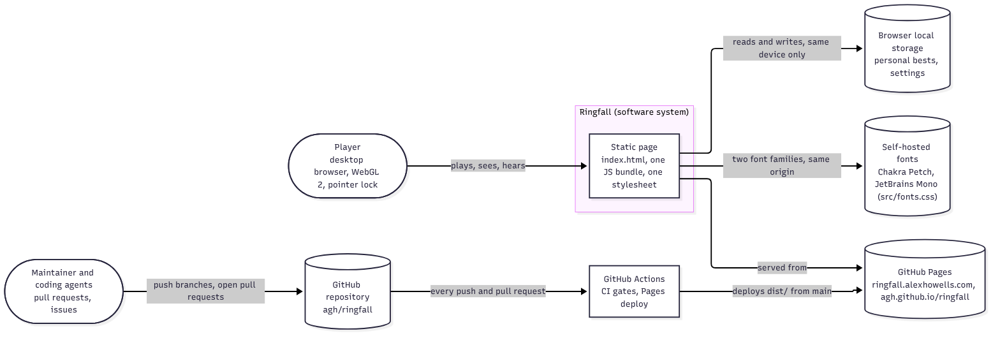
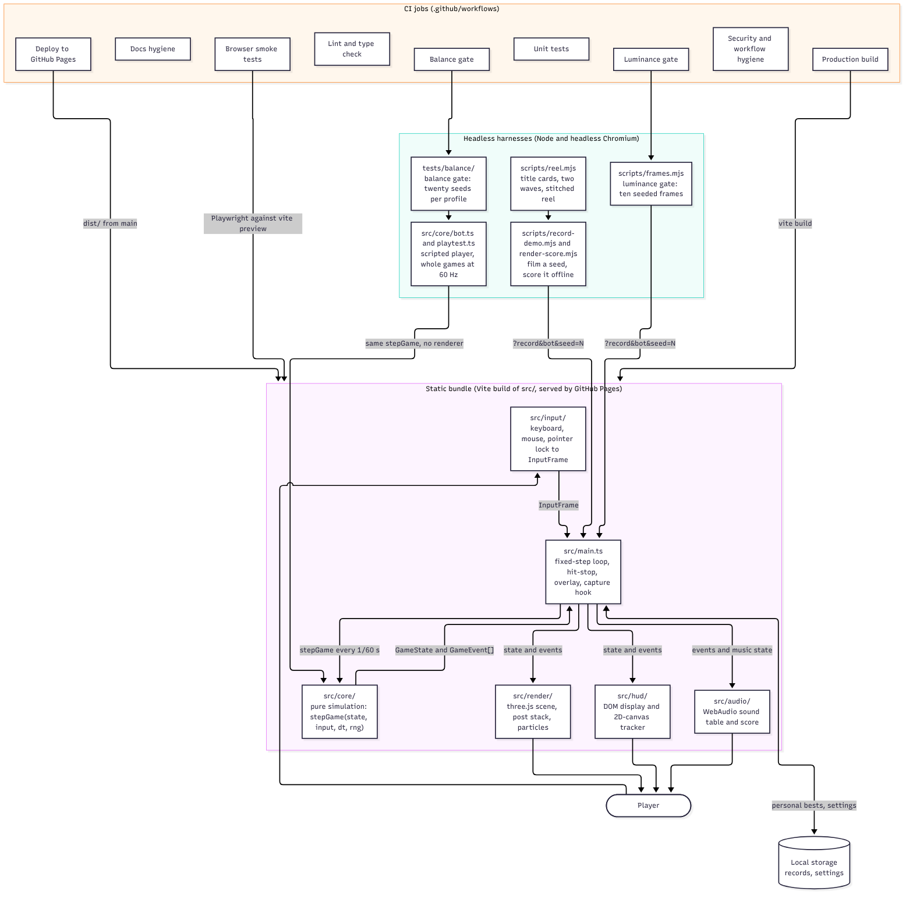
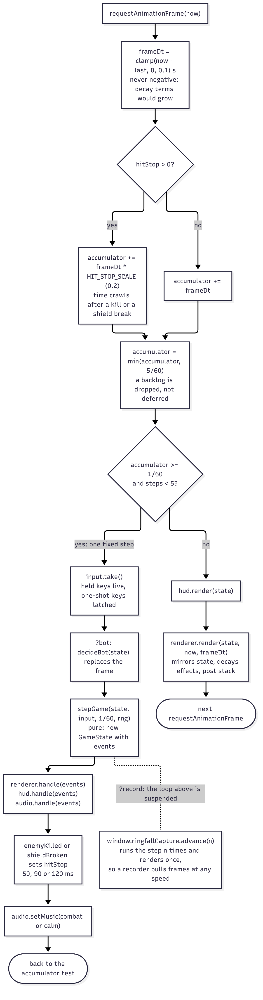
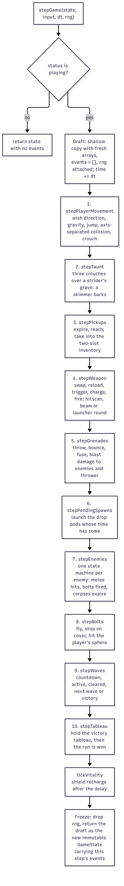
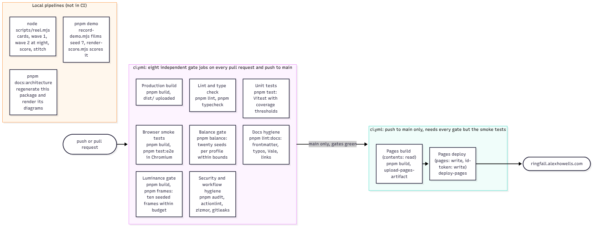

# Ringfall architecture

> [Ringfall](../../README.md) > [Design document](../design-doc.md) > Architecture

This package describes the structure of Ringfall, a browser-native arena
shooter rendered with three.js, at the four levels the
[C4 model](https://c4model.com/) names and in the two runtime views that
matter for this code: one animation frame and one simulation tick. It is
written to be read top-down in about twenty minutes by an engineer or an
agent who then opens `src/` without help. Every diagram is Mermaid under
[diagrams/](diagrams/), rendered to a PNG under [render/](render/) by
`pnpm docs:architecture`; the sources are the truth and the images are for
reading. Two documents in this folder are generated from the code rather
than written: the [module map](modules.md) comes from the import graph and
the [event catalogue](events.md) from the `GameEvent` union and the
switches that consume it. A unit test regenerates both and fails when
either differs from the checked-in file, so the counts and lists they hold
are never typed by hand.

| Section | Question it answers |
| ------- | ------------------- |
| [Context](#level-1-context) | Who and what is outside the system |
| [Containers](#level-2-containers) | What runs where: the bundle, its layers, the headless harnesses, CI |
| [Components](#level-3-components) | Every module under `src/core/` and `src/render/`, generated |
| [One frame](#one-frame) | How input becomes a step, events and three presentation layers |
| [One tick](#one-simulation-tick) | What `stepGame` does, in order |
| [Events](#event-catalogue) | Every `GameEvent`, who raises it, who consumes it, generated |
| [Build and delivery](#build-and-delivery) | The pnpm scripts, the CI jobs and what each gates, the deploy |
| [Decisions](#decision-index) | Which record governs which element |
| [Invariants](#invariants-and-constraints) | The rules the code is held to and the file that enforces each |

## Level 1: context

Ringfall is one static page with no backend. The player opens it in a
desktop browser with WebGL 2 and pointer lock; GitHub Pages serves it from
the custom domain, and the page fetches nothing else at runtime; the two
font families are self-hosted (`src/fonts.css`) and the content security
policy in `index.html` allows no other origin. The only data the page keeps is the player's
personal bests and settings, in that browser's local storage, and nothing
leaves the device. The maintainer and the coding agents they run change the
system through pull requests to the repository; every push runs the CI
gates and a push to `main` deploys the build.

Source: [diagrams/context.mmd](diagrams/context.mmd).

## Level 2: containers

The deployable unit is one Vite bundle built from `src/`. Inside it the
layers are directories with one job each: `src/input/` turns keyboard,
mouse and pointer lock into an `InputFrame`; `src/core/` is the pure
simulation; `src/render/`, `src/hud/` and `src/audio/` present the state
and the events; `src/main.ts` is the composition root that owns the loop.
Local storage sits beside the bundle. The same core runs in Node with no
renderer for the headless harnesses: the bot plays whole games for the
balance gate, and headless Chromium drives the built page through the
`?record&bot&seed=N` hook for the luminance gate, the demo recorder and the
reel. The CI jobs exercise those containers and the deploy job publishes
the bundle.

Source: [diagrams/containers.mmd](diagrams/containers.mmd).

| Container | Technology | Owns | Entry |
| --------- | ---------- | ---- | ----- |
| Static bundle | Vite 8, one HTML page, one JS chunk, one stylesheet | Everything the player runs | `index.html`, `src/main.ts` |
| Simulation core | TypeScript, no DOM, no WebGL, no clock | `GameState`, `stepGame`, the bot, the playtest | `src/core/game.ts` |
| Renderer | three.js `WebGLRenderer`, `EffectComposer` | Scene graph, post stack, particles, viewmodels | `src/render/scene.ts` |
| HUD | DOM and a 2D canvas | Vitals, ammo, announcements, motion tracker | `src/hud/hud.ts` |
| Audio | WebAudio oscillators and noise | Sound table, live score, offline score | `src/audio/audio.ts` |
| Input | DOM events and the pointer lock API | `InputFrame` per step | `src/input/input.ts` |
| Local storage | `localStorage` behind a two-method interface | Personal bests, settings | `src/core/records.ts`, `src/core/settings.ts` |
| Bot and playtest | Node, Vitest | Scripted player, whole games, balance summaries | `src/core/bot.ts`, `src/core/playtest.ts` |
| Balance gate | Vitest | Twenty seeds per profile against baseline-derived bounds | `tests/balance/` |
| Luminance gate | Playwright Chromium on software GL | Ten seeded frames measured against budgets | `scripts/frames.mjs` |
| Recorder and score | Playwright Chromium, ffmpeg, `OfflineAudioContext` | A seeded film and its soundtrack | `scripts/record-demo.mjs`, `scripts/render-score.mjs` |
| Reel | Playwright Chromium, ffmpeg | Title cards, two waves, stitched cut | `scripts/reel.mjs` |
| CI | GitHub Actions, every action pinned to a commit SHA | Eight gate jobs, then the Pages build and deploy on `main` | `.github/workflows/` |

## Level 3: components

The components are the modules. [modules.md](modules.md) is generated from
the import declarations under `src/`: it holds the dependency rule per
layer, a component diagram for the core and one for the renderer, and a
table with every module's responsibility and imports. A solid arrow is a
runtime import and a dotted arrow is type-only, which the bundle erases.
The generator refuses to run when an import crosses a layer the rule
forbids, so the diagrams cannot show a dependency the architecture does not
allow.

Two shapes are worth knowing before opening the file. In the core,
`game.ts` is the hub that imports every simulation system and nothing
imports it back except the bot, the playtest and the presentation layers;
the leaves are `vec3.ts`, `rng.ts`, `vitality.ts`, `records.ts` and
`settings.ts`. In the renderer,
`scene.ts` is the hub that owns the sub-renderers, `particles.ts` is the
shared pool that the environment, pickups and weapons draw into, and every
module imports three.js directly.

## One frame

`src/main.ts` runs a fixed-timestep accumulator. Each
`requestAnimationFrame` callback adds the elapsed wall time, clamped to
between zero and a tenth of a second, to an accumulator, then steps the
simulation at exactly 1/60 s while at least that much time is banked,
capped at five steps per frame; anything banked beyond that cap is dropped
rather than deferred, so a stalled tab never fast-forwards. Each step takes one `InputFrame` from the
input controller (or from the bot in `?bot` mode), calls `stepGame`, and
fans the returned events out to the renderer, the HUD and the audio bank,
in that order. After the steps the HUD renders the state and the renderer
draws one frame.

Three annotations on the diagram explain behavior that is easy to miss in
the code. Hit-stop: an `enemyKilled` or `shieldBroken` event sets a
countdown during which the accumulator fills at a fifth of real speed (`HIT_STOP_SCALE`), so time
crawls for a few frames. The clamp: the first frame after `start()` can
carry a timestamp earlier than the one captured in `start()`, and a negative
delta would make every decay term grow, so the delta is never negative. The
capture hook: with `?record` the animation loop is suspended and
`window.ringfallCapture.advance(n)` runs n steps and renders once, so the
recorder, the luminance gate and the reel pull frames at whatever speed the
GPU allows and reassemble them at 60 Hz.

Source: [diagrams/frame.mmd](diagrams/frame.mmd).

## One simulation tick

`stepGame(state, input, dt, rng)` in `src/core/game.ts` is pure with
respect to its arguments. A state that is not `playing` is returned with
no events. Otherwise the function makes a mutable draft (a shallow copy
with fresh arrays, an empty event list and the generator attached),
advances the clock, runs the systems in a fixed order, ticks the shield,
drops the generator and returns the draft as the next immutable state. The
order matters: movement runs first so weapons fire from the new eye
position, pickups are taken before the trigger is read so a fresh weapon
can fire in the same step, grenades burst before enemies move, bolts fly
after enemies have fired them, and the wave system sees the step's deaths.

Source: [diagrams/tick.mmd](diagrams/tick.mmd).

## Event catalogue

[events.md](events.md) is generated from `src/core/game.ts` and the files
that consume events. For every member of the `GameEvent` union it lists the
payload fields, the function inside `stepGame` that pushes it, which
presentation files switch on it and whether the HUD announces it, and its
entry in the sound table or the `SILENT` list in `src/audio/sounds.ts`. The
bot is scanned too and consumes nothing, which the catalogue says in its
own words: it reads `GameState`, as a player reads the screen. An event
that is declared but never pushed, or pushed but not declared, is a
generator error.

## Build and delivery

Everything a contributor runs is a pnpm script in `package.json`, and CI
runs the same scripts.

| Script | What it does |
| ------ | ------------ |
| `pnpm dev` | Vite dev server with hot reload on port 5173 |
| `pnpm build` | `tsc --noEmit`, then `vite build` to `dist/` |
| `pnpm preview` | Serves `dist/` on port 4173; Playwright and the harnesses use it |
| `pnpm lint`, `pnpm lint:fix` | Biome in CI mode, markdownlint, stylelint and Prettier on CSS; the fix variant rewrites |
| `pnpm audit` | Production dependency advisories at high severity or above |
| `pnpm typecheck` | Strict `tsc --noEmit` |
| `pnpm test` | Vitest unit and balance suites with V8 coverage thresholds on `src/core/` |
| `pnpm test:e2e` | Playwright smoke tests in real Chromium against `vite preview` |
| `pnpm check` | lint, typecheck, test, build: what a pull request must pass locally |
| `pnpm lint:docs` | Frontmatter schema, typos, Vale (advisory), internal links |
| `pnpm docs:architecture` | Regenerates this package's generated files and renders the diagrams |
| `pnpm frames` | The luminance gate against a production build |
| `pnpm balance` | The balance gate; writes `test-results/balance/` |
| `pnpm demo` | Films seed 7 and scores it into `demo.mp4` |

The one workflow, `.github/workflows/ci.yml`, runs eight independent gate
jobs on every pull request and every push to `main`; a pull request push cancels a
superseded run, a push to `main` always runs to completion. Two more jobs,
Pages build and Pages deploy, run only on a push to `main` and only after
every gate except the luminance gate and the browser smoke tests has
passed (#100), so a merge never
publishes a build that failed a gate. Every action is pinned to a commit
SHA and checkouts do not persist credentials; the deploy job is the only
one with write permission.

| Job | Gates | Artifact |
| --- | ----- | -------- |
| Lint and type check | Biome, markdownlint, strict TypeScript | none |
| Unit tests | Every core rule and the coverage thresholds in `vitest.config.ts` | `coverage` |
| Browser smoke tests | The built page loads, starts, advances, moves on keys, no page errors | `playwright-report` (the HTML report and the traces) on failure |
| Luminance gate | Ten seeded frames within the mean and blob budgets in `scripts/frames.mjs` | `frames` |
| Production build | `vite build` succeeds | `dist` |
| Balance gate | Twenty seeded games per profile within `tests/balance/gate.ts` | `balance-report`, also appended to the job summary |
| Docs hygiene | Frontmatter, typos, Vale, internal links; external links advisory | none |
| Security and workflow hygiene | `pnpm audit`, actionlint, zizmor and gitleaks; actionlint and gitleaks pinned by checksum, zizmor by version | none |
| Pages build | `main` only, after the fast gates: `pnpm build` and `upload-pages-artifact` | `github-pages` |
| Pages deploy | `main` only, after Pages build: `deploy-pages` with `pages: write` and an OIDC token | the live site |

Source: [diagrams/build.mmd](diagrams/build.mmd).

The recorder pipeline (`pnpm demo`) and the reel (`node scripts/reel.mjs`)
are local: they need a production build, headless Chromium and a full
ffmpeg, and their output is reviewed by a person and logged under
[journey/](../journey/README.md). [runbook.md](../runbook.md) holds the
procedures.

## Decision index

Each architecture decision record and each row of the
[decision index](../decisions.md) governs an element of the diagrams above.

| Element | Decision | Record |
| ------- | -------- | ------ |
| Static bundle, renderer | TypeScript, three.js on WebGL, Vite; every dependency pinned | [ADR-0001](../adr/0001-typescript-three-vite.md) |
| Simulation core, one tick, one frame | A pure `stepGame` over immutable state, seeded randomness, a fixed 60 Hz accumulator capped at five steps | [ADR-0002](../adr/0002-pure-simulation-core.md) |
| Renderer, audio, every name in the code | Original names, procedural visuals, synthesized audio; no franchise material | [ADR-0003](../adr/0003-original-ip-only.md) |
| GitHub Pages | Vite's static `dist/` is the deployable; Pages hosts it from `main` | [decisions.md](../decisions.md), "Bundle and serve with Vite" |
| CI | Every dependency pinned to an exact version and every action to a commit SHA | [decisions.md](../decisions.md), "Pin every dependency" |
| Recorder, capture hook | A deterministic recorder that steps the simulation once per captured frame instead of screen capture | [decisions.md](../decisions.md), "Film the demo with a deterministic recorder" |
| Offline score | The soundtrack is rendered offline from the same seeded event timeline | [decisions.md](../decisions.md), "Render the soundtrack offline" |
| Local storage | Personal bests stay in the browser; missing or corrupt storage is a clean slate | [decisions.md](../decisions.md), "Keep personal bests in the browser's local storage" |
| Browser smoke tests | The smoke test waits on simulation time, not on a wave, and idle title rendering is throttled | [decisions.md](../decisions.md), "Make the browser smoke test wait on simulation time" |
| Post stack | Bloom threshold above 1.0 in HDR, ACES tone mapping at a fixed exposure | [decisions.md](../decisions.md), "Keep the bloom threshold above 1.0" |
| Wave system | Five named beats (`WAVE_BEATS`) with drop pods and a victory tableau, superseding the eight-wave formula (#57) | [decisions.md](../decisions.md), "Ship eight uniform waves" (overruled by #57) |
| Environment | The ring is a torus the player stands on, so the arc rises on both horizons | [decisions.md](../decisions.md), "Make the ring a torus" |

## Invariants and constraints

These are the rules the code is held to. Each one names the file that
enforces it, so a reader can find the gate before changing the behavior.

| Invariant | Rule | Enforced by |
| --------- | ---- | ----------- |
| Core purity | Nothing under `src/core/` imports three.js or touches `window`, `document`, the clock or `Math.random` | Biome override in `biome.json`; `tests/unit/purity.test.ts`; the layer rule in `scripts/architecture.mjs` |
| Layering | Each layer imports only the layers its row in the module map allows | `ALLOWED` in `scripts/architecture.mjs`, run by `tests/unit/architecture.test.ts` |
| Determinism from a seed | Arena layout, AI jitter and the bot derive from `createRng(seed)`; the clock seeds production only | `src/core/rng.ts`; the determinism assertions in `tests/unit/bot.test.ts`; `parseSeed` in `src/core/rng.ts` for `?seed=` |
| Frame budget | The simulation steps at exactly 1/60 s, at most five steps per frame, and the frame delta is clamped to between 0 and 0.1 s | `FIXED_DT`, `MAX_STEPS_PER_FRAME` and the `frameDt` clamp in `src/main.ts` |
| Particle cap | One `Points` draw call with a fixed pool, sprites capped at 64 px and faded inside two meters of the eye | The pool capacity and the vertex shader in `src/render/particles.ts` |
| Luminance budget | Ten seeded frames keep a mean under the day and night budgets with no saturated blob over the limit | `BUDGET` and `FRAME_SET` in `scripts/frames.mjs`; the CI `Luminance gate` job |
| Balance | Twenty seeded games per bot profile stay within baseline-derived bounds | `GATE_THRESHOLDS` in `tests/balance/gate.ts`; the CI `Balance gate` job |
| Coverage | `src/core/` is covered to the thresholds | `coverage.thresholds` in `vitest.config.ts` |
| Design numbers | Every gameplay number quoted in the design document equals the constant that owns it | `tests/unit/design-doc.test.ts` |
| Generated documentation | The module map, the component diagrams and the event catalogue equal the generator's output | `tests/unit/architecture.test.ts` |
| Original work | No franchise names, assets, audio or lore | `tests/unit/originality.test.ts`; [ADR-0003](../adr/0003-original-ip-only.md) |
| Supply chain | Exact versions, a release age floor, no dependency lifecycle scripts, actions pinned to SHAs | `package.json`, `pnpm-workspace.yaml`, `.github/workflows/` |
| Content security | The page loads only itself and the two font hosts; no inline scripts | The `Content-Security-Policy` meta tag in `index.html` |
| Nothing leaves the device | Records and settings are read and written through a two-method storage interface, never sent anywhere | `src/core/records.ts`, `src/core/settings.ts` |

## Keeping the package honest

`scripts/architecture.mjs` reads the TypeScript source with the compiler
API and writes four files: the two component diagrams, the module map and
the event catalogue. `pnpm docs:architecture` runs it and then renders every
Mermaid source under `diagrams/` to `render/` with mermaid-cli, which needs
a Chromium (Puppeteer's own, or the one named by
`PUPPETEER_EXECUTABLE_PATH`). `node scripts/architecture.mjs --check`
exits non-zero when a generated file is out of date, and
`tests/unit/architecture.test.ts` does the same inside `pnpm test`, so the
unit job in CI fails on drift. The hand-written diagrams (context,
containers, frame, tick, build) are reviewed like prose; when a container
or a loop step changes, change the diagram in the same pull request.
