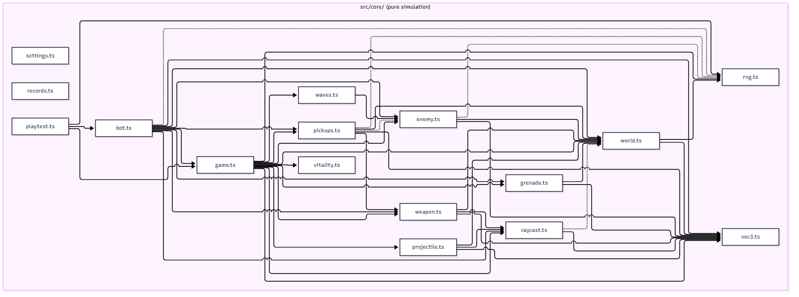
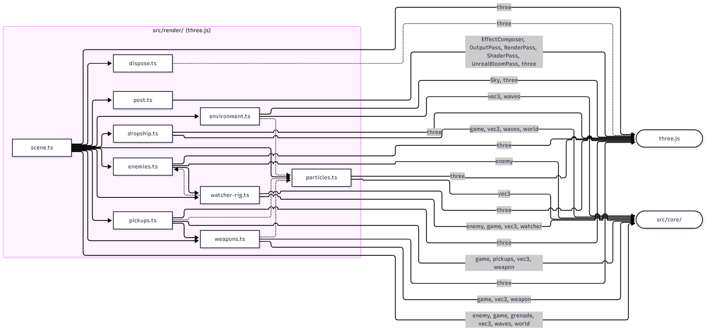

<!-- Generated by scripts/architecture.mjs; edit the script, not this file. `pnpm docs:architecture` rewrites it and tests/unit/architecture.test.ts fails when it drifts from the code. -->

# Ringfall module map

> [Ringfall](../../README.md) > [Architecture](README.md) > Module map

Every TypeScript module under `src/` with its responsibility and what it imports, read from the import declarations by `scripts/architecture.mjs`. The tree holds 34 modules in 6 layers (`audio`, `core`, `hud`, `input`, `main`, `render`) joined by 117 internal imports. A dotted arrow in the diagrams is a type-only import, which Vite erases from the bundle; a solid arrow carries runtime code.

## Allowed dependencies

The generator refuses to run when an import crosses a line this table does not allow, so the table is a rule the code is held to, not a description of it. Biome and `tests/unit/purity.test.ts` enforce the core row a second way.

| Layer | May import | Why |
| ----- | ---------- | --- |
| `core` | `core` | The simulation runs in Node with no renderer, DOM, clock or unseeded randomness ([ADR-0002](../adr/0002-pure-simulation-core.md)) |
| `render` | `render`, `core`, `three` | The only layer that owns WebGL objects ([ADR-0001](../adr/0001-typescript-three-vite.md)) |
| `hud` | `core` | DOM and 2D canvas only; it reads state and events |
| `input` | `core` | Produces the `InputFrame` the core consumes |
| `audio` | `audio`, `core` | WebAudio only; the offline score re-runs a core playtest |
| `main` | every layer | The composition root wires the others together |

## Core components

C4 level 3 for `src/core/`. Every arrow is an import; the core imports nothing outside itself.

Source: [diagrams/core-components.mmd](diagrams/core-components.mmd).

## Renderer components

C4 level 3 for `src/render/`. Imports from the core are collapsed into one node and labeled with the modules they come from; three.js is the only external dependency.

Source: [diagrams/render-components.mmd](diagrams/render-components.mmd).

## Module table

| Module | Layer | Responsibility | Imports |
| ------ | ----- | -------------- | ------- |
| `src/audio/audio.ts` | `audio` | `AudioBank`: the WebAudio context, buses, the charge hum and the event-to-sound dispatch | `core/game` (types), `audio/music`, `audio/sounds` |
| `src/audio/music.ts` | `audio` | Live score: choir drone, pulse and percussion scheduled against the wall clock | `audio/sounds` |
| `src/audio/offline.ts` | `audio` | Offline score: re-runs a seeded playtest and renders its events into an `OfflineAudioContext` | `core/game` (types), `core/playtest`, `audio/sounds` |
| `src/audio/sounds.ts` | `audio` | The procedural sound table keyed by event, the `SILENT` list and the voice scheduler | `core/game` (types), `core/weapon` |
| `src/core/bot.ts` | `core` | Scripted player: reads the state a human could see and returns an `InputFrame` | `core/enemy`, `core/game`, `core/grenade`, `core/pickups` (types), `core/raycast`, `core/rng` (types), `core/vec3`, `core/weapon`, `core/world` (types) |
| `src/core/enemy.ts` | `core` | Enemy state machine (`spawning`, `chase`, `attack`, `flee`, `dead`), skimmer temperaments, the rout and its bark lines | `core/rng` (types), `core/vec3`, `core/watcher`, `core/world` |
| `src/core/game.ts` | `core` | `GameState`, `InputFrame`, the `GameEvent` union and `stepGame`: one simulation tick as a draft, eight systems in order, then a frozen state | `core/enemy`, `core/grenade`, `core/pickups`, `core/projectile`, `core/raycast`, `core/rng`, `core/vec3`, `core/vitality`, `core/waves`, `core/weapon`, `core/world` |
| `src/core/grenade.ts` | `core` | Thrown grenades and launcher rounds: bounce, fuse, blast falloff | `core/vec3`, `core/world` |
| `src/core/pickups.ts` | `core` | Weapon pickups: drops, wave rewards, expiry, reach and the two-slot inventory | `core/enemy` (types), `core/rng` (types), `core/vec3`, `core/weapon`, `core/world` |
| `src/core/playtest.ts` | `core` | Headless games at 60 Hz, balance summaries and the gate evaluation | `core/bot`, `core/game`, `core/rng` |
| `src/core/projectile.ts` | `core` | Strider bolts: flight, cover and floor stops, the hit sphere | `core/raycast`, `core/vec3`, `core/world` (types) |
| `src/core/raycast.ts` | `core` | Ray against sphere and axis-aligned box; hitscan against targets and cover | `core/vec3` (types), `core/vec3`, `core/world` (types) |
| `src/core/records.ts` | `core` | Personal bests over a tiny storage interface; the browser passes `localStorage` | none |
| `src/core/rng.ts` | `core` | Seeded mulberry32 generator so every run is reproducible | none |
| `src/core/settings.ts` | `core` | Sensitivity, field of view and motion toggles over the same storage interface | none |
| `src/core/vec3.ts` | `core` | Immutable vector helpers and `directionFromAngles`, the single source of the yaw and pitch convention | none |
| `src/core/vitality.ts` | `core` | Regenerating shield over fixed health; damage order and recharge | none |
| `src/core/watcher.ts` | `core` | The watcher archetype: holds a perimeter band, strafes, telegraphs and fires a hitscan beam that cover stops | `core/enemy` (types), `core/raycast`, `core/rng` (types), `core/vec3`, `core/world` |
| `src/core/waves.ts` | `core` | Wave state machine, composition formula, `FINAL_WAVE`, the atmosphere table | `core/enemy` (types) |
| `src/core/weapon.ts` | `core` | Six weapon kinds as data in `WEAPON_SPECS`; magazine, reload, trigger, charge, spin-up and falloff rules | `core/raycast`, `core/vec3` (types), `core/world` (types) |
| `src/core/world.ts` | `core` | Seeded arena generation, cover boxes, the hidden switch, axis-separated collision | `core/rng` (types), `core/vec3` |
| `src/hud/hud.ts` | `hud` | DOM heads-up display, announcements, hit marker, damage direction and the 2D-canvas motion tracker | `core/game`, `core/vec3` (types), `core/waves`, `core/weapon`, `core/world` |
| `src/input/input.ts` | `input` | Keyboard, mouse, wheel and pointer lock into an `InputFrame`; one-shot actions latched between steps | `core/game`, `core/vec3` |
| `src/main.ts` | `main` | Fixed 60 Hz accumulator loop, hit-stop, overlay and pointer-lock lifecycle, settings panel, the `?record` capture hook | `audio/audio`, `audio/offline`, `core/bot`, `core/game`, `core/records`, `core/rng`, `core/settings`, `hud/hud`, `input/input`, `render/scene` |
| `src/render/dispose.ts` | `render` | `disposeTree`: frees geometry, materials and textures under an object before it is dropped | `three` (types) |
| `src/render/dropship.ts` | `render` | The dropship: a Hull craft that crosses the arena on the first dropPod of a wave, and the pods that fall from it | `three`, `core/game` (types), `core/vec3` (types), `core/waves`, `core/world` |
| `src/render/enemies.ts` | `render` | Composite enemy rigs built from primitives, with their animation | `three`, `core/enemy`, `render/watcher-rig` |
| `src/render/environment.ts` | `render` | Sky, sun and moon, the ring, terrain, stars, the atmosphere rigs and weather overlays | `three`, `three/addons/objects/Sky.js`, `core/vec3` (types), `core/waves` (types), `render/particles` (types) |
| `src/render/particles.ts` | `render` | GPU particle pool: one `Points` draw call, birth state written once, integrated in the vertex shader | `three`, `core/vec3` (types) |
| `src/render/pickups.ts` | `render` | Pickup emblems, halos and the spawn and take flourishes | `three`, `core/game` (types), `core/pickups` (types), `core/vec3` (types), `core/weapon` (types), `render/particles` (types), `render/weapons` |
| `src/render/post.ts` | `render` | HDR composer: render pass, capped bloom prefilter, feel pass, ACES output | `three`, `three/addons/postprocessing/EffectComposer.js`, `three/addons/postprocessing/OutputPass.js`, `three/addons/postprocessing/RenderPass.js`, `three/addons/postprocessing/ShaderPass.js`, `three/addons/postprocessing/UnrealBloomPass.js` |
| `src/render/scene.ts` | `render` | `SceneRenderer`: owns the three.js scene, camera and post stack; mirrors `GameState` every frame and plays effects for events | `three`, `core/enemy` (types), `core/game`, `core/grenade`, `core/vec3` (types), `core/waves`, `core/world`, `render/dispose`, `render/dropship`, `render/enemies`, `render/environment`, `render/particles`, `render/pickups`, `render/post`, `render/watcher-rig`, `render/weapons` |
| `src/render/watcher-rig.ts` | `render` | The watcher rig: a tall tripod with a lens that brightens over the charge, and the beam layer | `three`, `core/enemy` (types), `core/game` (types), `core/vec3` (types), `core/watcher`, `render/enemies` (types) |
| `src/render/weapons.ts` | `render` | One viewmodel rig per weapon kind: draw, recoil, muzzle flash, tracers, beam and launcher effects | `three`, `core/game` (types), `core/vec3` (types), `core/weapon`, `render/particles` (types) |
