# The journey

A time-indexed log of how Ringfall was built in four hours, 14:08 to
18:30 UTC on 2026-10-21, with the frames that were captured along the way. Times are UTC on
2026-10-21; the user's clock ran seven hours behind (10:12 for 17:12 UTC)
and the hard stop was 18:30 UTC. Each entry says what was tried, what was
seen, and what was decided, so a reader can follow the reasoning and not
just the result. Images live in `images/` and are named by the minute they
were captured.

## The story, not the straight line

The session had four acts. The second started with a correction, and the
fourth with a change of role.

**Act one: a working game in forty minutes.** The first decisions were
made fast and have held: TypeScript on the house toolchain, three.js on
WebGL, a simulation written as a pure function so it could be tested in
Node, original names and procedural art only. The core (collision, rifle,
grenades, two enemies, waves, shields) was written and tested before a
single triangle was drawn. The first renderer was deliberately plain: flat
boxes, a dark sky, a torus on the horizon. It shipped as a draft PR at
14:30 with CI, a Pages deploy, and ninety-nine percent line coverage.

**The correction.** The brief that followed was blunt: the graphics were
not pushing boundaries, and the project needed a product backlog, a brand,
a journey log, a demo film, and a way for the agent to play the game rather
than screenshot it. The first renderer had been a call made for speed; it
was the wrong level of ambition for the demo, and that was named plainly.
Rather than polish the v1 scene, it was rewritten.

**Act two: the renderer rewrite, and three bugs in a black frame.** The
second renderer (scattering sky, a ring you stand on, terrain, image-based
lighting, GPU particles, an HDR composer with bloom and a feel pass) came
up black. It took forty minutes and a dozen headless captures with URL
flags to split that one symptom into three unrelated faults: the camera was
inside the ring's tube; the first animation frame after Deploy carried a
negative delta that made every decay term grow until the lights blew out;
and the terrain under the arena was fighting the floor in the depth buffer
at range. Each fix was small. Finding them was the work. Most flags were
removed afterwards; `?nopost`, the uniform probe, and the `ringfallDebug`
global stayed as documented diagnostics.

**Act three: the game plays itself.** Determinism paid off. The same seeded
`stepGame` that a person drives became a bot's playground: a headless
harness measures win rate and wave clear times in seconds, a Playwright run
proves the real stack in a real browser, and a recorder steps the sim once
per captured frame so the film plays at the right speed on a software GPU
that renders at under one frame per second. The soundtrack is rendered
offline from the same event timeline, which is why audio recorded minutes
later lines up with the frames.

Meanwhile three research agents ran in parallel and came back with sourced
reports on the design philosophy being borrowed, the browser prior art, and
a brand system. Their findings became the specification, the brand doc,
and a backlog of GitHub issues, each with acceptance criteria a person can
check; it started at seventeen and stood at thirty-three by 17:24.

**Act four: the coach.** With two and a half hours left the asks came five
at a time (day and night, six weapons, weather, a story reel, a domain)
and the role changed: dispatch to agents, review what comes back, land
the code. The first round was four local streams with disjoint files; it
landed, but the flare the user had complained about survived two rounds
of tuning because nobody had measured a frame. The second round, after
main was merged, was thirteen cloud sessions, one issue each, with a
luminance gate among them so the next tuning argument is a number. The
entries from 16:05 on are that act.

### Calls that were made, then overruled

- **A plain first renderer.** Chosen for speed; judged insufficient for the
  demo. Rewritten in act two. The lesson recorded in the spec: the first
  thirty seconds are the product.
- **Eight uniform waves.** A formula was faster to write than a composition
  table. The research on pacing says five named beats with a late
  spectacle. Deferred to issue #8 rather than done in the window; the
  constant is one line.
- **Screenshots as proof of play.** Replaced by the bot, the harness, and
  the recorder. Screenshots remain as evidence, not as the test.
- **One squashed commit for act two.** Everything from the renderer to the
  docs landed in a single commit because the clock mattered more than
  history. Later changes went back to one concern per commit.
- **Holding PR #1 as a draft until the reel landed.** The coach wanted
  the film in the tree before main took anything. The user wanted main
  unblocked first so other agents could branch from it. That was right:
  thirteen agents were about to branch from it. Merged at 17:07 as
  8566f27.

### Calls that were wrong on the evidence

Not overruled by anyone; found out by measuring.

- **Briefing the flare fix as light numbers.** The coach sent stream A
  exact intensities and opacities. The frame stayed white because the
  cause was the particle size law, which a headless replay and a read of
  the shader found in ten minutes (16:45 entry).
- **Filing frames under guessed times.** The first journey frames of the
  afternoon were named by the time the entry was written, not captured.
  Renamed in 627c55d; the audit's warning about timestamps applied to the
  coach too.
- **A checkpoint commit to satisfy the stop hook.** It swept an agent's
  scratch harness into the tree and broke CI lint for one run (16:35 to
  16:42). Checkpoints now go through the same gates as any commit.
- **An ambiguous brief.** "Wave 1 unchanged" and "day: sun at 35 degrees"
  in one brief to stream A; the agent chose the first and flagged it (16:05
  entry).
- **Shipping the interim reel from a stale build.** The 16:47 cut was
  captured on a 16:11 build with the old flare (17:15 entry).
- **Claiming a fix that was not made.** The first audit recorded a recorder
  frame-rate guard as fixed; only the demo's frame rate changed (second
  audit).

## 14:08 Kick-off

The brief: a WebGL game inspired by a classic console shooter, in a
browser, three hours, to the crefft engineering standards. First decisions
within ten minutes: TypeScript, three.js on WebGL, Vite, a pure simulation
core so the game logic is unit-testable in Node, original names and
procedural art only.

## 14:08 to 14:27 Core and first renderer

The simulation (`src/core/`) was written first: vector helpers, a seeded
random source, arena generation with sliding collision, hitscan against
spheres and boxes, a shield-over-health model with a recharge delay, a
magazine-fed rifle, bouncing grenades, two enemy archetypes, slow bolts,
and the wave state machine. Forty-five unit tests, 99% line coverage. The
first renderer was flat-shaded boxes under a dark navy sky with a torus on
the horizon.

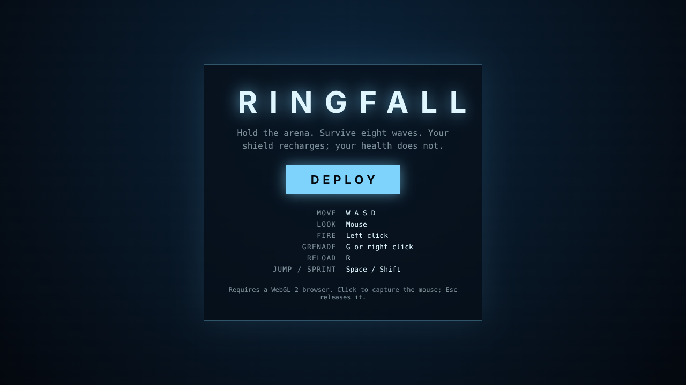

The first in-game frame confirmed the loop worked end to end: HUD, radar,
ring, enemies closing in.

## 14:30 First push, draft PR, research dispatched

Six Conventional Commits, CI with SHA-pinned actions, a GitHub Pages deploy,
and a draft PR. Three research agents were dispatched in parallel: the reference console shooter's
design philosophy and an MLP cut, prior art in browser WebGL games, and a
brand system. Their reports are under [`../research/`](../research/) and
[`../brand.md`](../brand.md).

## 14:34 to 15:05 Renderer v2 and three bugs

The brief said "10x more sophisticated". The second renderer added a
scattering sky, a ring you actually stand on (six kilometers in radius,
sunk below the horizon so it rises on both sides and crosses overhead),
rolling terrain with mountains at the rim, image-based lighting from the
sky, a GPU particle pool, an HDR composer with bloom, a custom feel pass
(vignette, chromatic aberration, hex shield lattice), composite enemy rigs,
and weapon sway, bob, and recoil.

It rendered black. Three separate faults, found by bisecting with URL
flags and headless screenshots:

1. **The camera was inside the ring.** The torus tube was larger than the
   amount it was sunk below the floor, so the inner surface wrapped the
   player. Fix: sink the ring further than the tube radius.
2. **A negative frame delta.** The first animation frame after Deploy
   carried a timestamp earlier than the clock set in `start()`, so every
   decay term (recoil, muzzle light, damage flare) ran backwards and grew
   without bound. The scene went white and the HDR target looked broken.
   Fix: clamp the delta at zero. The uniform probe that found it is still
   in the code.
3. **Terrain fighting the floor.** The terrain under the arena sat 0.6 m
   below the floor, but with a 0.08 m near plane and a 40 km far plane the
   depth buffer could not separate them at ten meters. Fix: sink the inner
   terrain six meters.

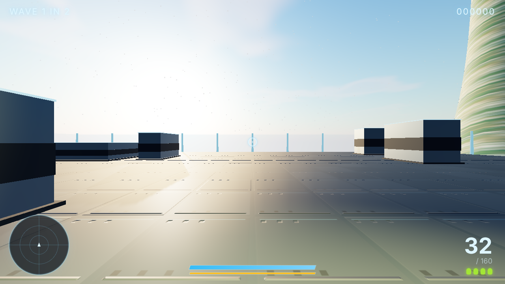

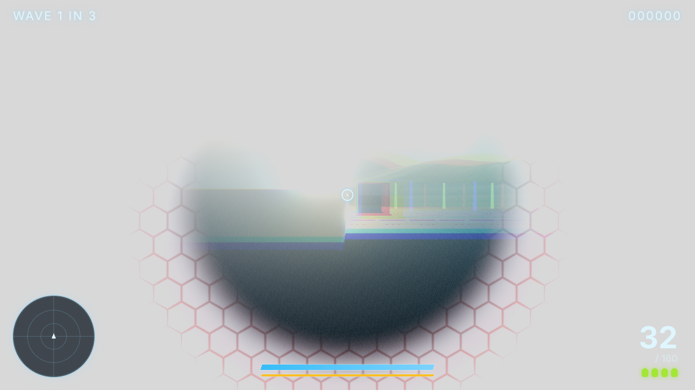

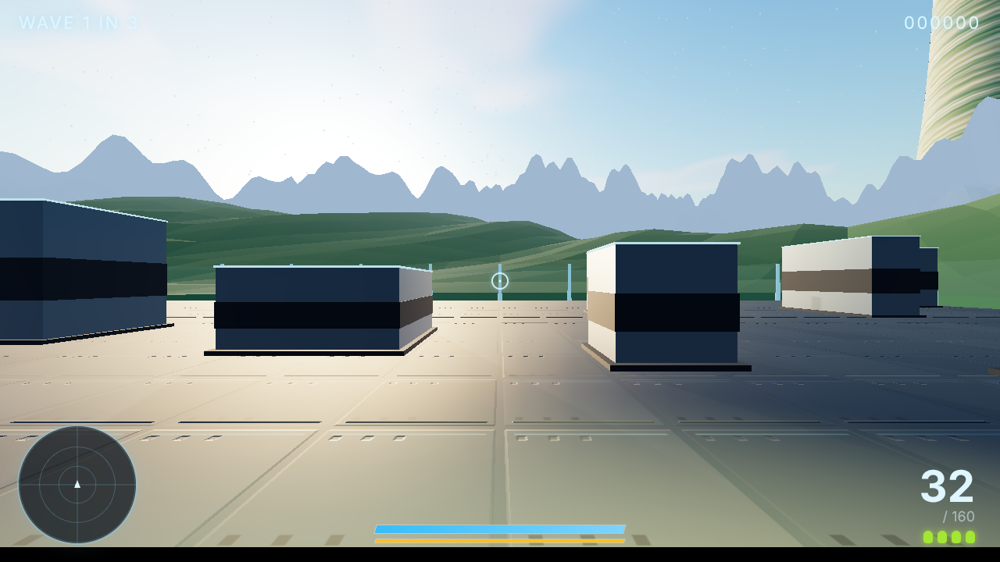

## 15:05 Procedural score

A choir drone in D minor (three detuned oscillators per voice, vowel
formant filters drifting between "ah", "oh" and "oo", a synthesized
cathedral impulse response) with calm and combat buses that crossfade on
wave state. No samples anywhere.

## 15:06 The bot that plays the game

`src/core/bot.ts` turns the immutable state into an `InputFrame` the way a
person would: bounded turn rate, aim jitter, strafe bursts, bolt dodging,
retreat on low shield, grenades at clusters. `src/core/playtest.ts` runs it
headless at 60 Hz and reports win rate, accuracy, shield breaks, and
per-wave clear times. Because the sim is deterministic, the same seed
drives balance measurement, browser smoke tests, and the demo film.

## 15:14 Renderer v2 with the post stack, working

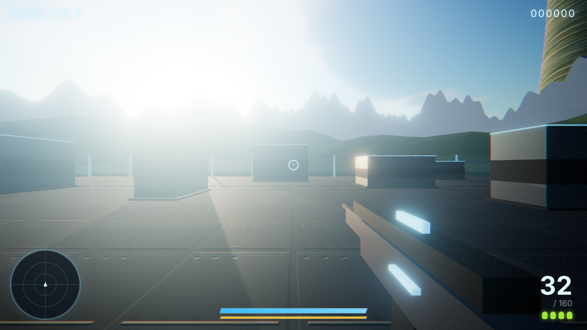

## 15:17 Backlog landed

Seventeen GitHub issues: an MLP epic with eleven children (shield-break
event, enemy theater, grenade dives, firing points, five named waves,
stingers and title choreography, brand compliance, frame budget, playtest
gate, demo pipeline, easter eggs) and a Later epic with four explicitly
deferred items. Each child has context, scope, acceptance criteria, and an
out-of-scope line.

## 15:20 Recording the demo

`scripts/record-demo.mjs` opens the built page with `?record&bot&seed=7`,
steps the simulation a whole number of ticks per captured frame (the
frame rate should divide 60, which the recorder does not enforce; an earlier run at 24 fps rounded to three ticks
and played a fifth too fast, which the audit caught), and assembles the
frames with ffmpeg. On a software GPU the capture runs far slower than
real time; the film still plays at the right speed because the sim is
stepped, not timed.

## 15:30 Soundtrack without a clock

Headless Chromium cannot play audio, and the live score schedules against
wall-clock time. `src/audio/offline.ts` re-runs the same seed headlessly to
recover the event timeline, schedules every voice, drum and effect into an
`OfflineAudioContext`, and returns a WAV that `scripts/render-score.mjs`
muxes into the silent capture. Determinism makes the audio line up with
frames rendered minutes apart.

## 15:45 HUD v2 and the full-tab experience

The second presentation pass: Deploy requests fullscreen, the HUD is
sized in viewport units so it fits any laptop, a segmented shield arc sits
over the health arc, the tracker sweeps, a compass strip shows heading
and hostile bearings, damage segments orbit the reticle pointing at the
source, the magazine is drawn as pips, and the brand fonts and tokens are
finally applied. The renderer gained a sun flare, airborne dust, hit-stop
on kills and shield breaks, death and victory cameras, and a frame-time
driven resolution scaler. The first flare used the three.js addon and
failed on the multisampled target; it was replaced with sprites.

## 15:50 The audit

An unanchored reviewer audited the whole repository for agent slop and
scored it two and a half out of five: real code, clean prose, but
documents running ahead of the code and one real bug in the recorder's
frame stepping. The findings and what was done with each are in
[audit.md](../audit.md). The one that stung: the bot "sees what a human
sees" sentence was false (it read enemy health and targeted enemies
beyond the tracker). It is true now.

### Balance baseline

First printed run of `pnpm balance` after the bot was made fair, twenty
seeds per profile, 480 s cap:

| Profile | Win rate | Mean waves cleared | Mean seconds | Accuracy | Shield breaks |
| ------- | -------- | ------------------ | ------------ | -------- | ------------- |
| Steady | 0% | 3.40 | 342 | 41% | 0.40 |
| Reckless | 0% | 3.55 | 302 | 38% | 0.45 |

No profile reaches wave eight. Either the bot is too weak or the later
waves are too hard for a five-to-ten-minute demo; issue #8 (five named
waves) and #12 (the balance gate) decide which. Until then this table is
the baseline every tuning change is measured against.

## 16:05 Coach, not player

The sixth ask was six things at once: day and night per wave, a
ninety-second story reel, six weapons with a swap key, weather, a custom
domain, and a change of role: dispatch to agents, review their outcomes,
land the code. Four streams were cut with disjoint file ownership so they
could not collide: A owned the environment and the lighting hook in the
scene, B1 the simulation, input and HUD for weapons, B2 the weapon
viewmodels, pickup meshes and sounds (started after B1 landed), C the
reel script and its cards. The coach's job became reading hand-backs,
checking frames, running the gates and writing commits. Two things went
wrong with that. A checkpoint commit made to satisfy the stop hook swept
an agent's scratch harness into the tree and broke CI lint for one run.
And a brief that said both "wave 1 unchanged" and "day: sun at 35
degrees" was resolved by the agent in favor of the first; the right
call, flagged in its report, and the kind of ambiguity a coach should not
write.

### Balance after weapons

Stream B1 landed the six weapons at 16:22 (b09ff28) and re-ran
`pnpm balance` with the same twenty seeds and 480 s cap. This replaces the
15:50 table as the baseline the gate in #12 is set against.

| Profile | Win rate | Mean waves cleared | Accuracy |
| ------- | -------- | ------------------ | -------- |
| Steady | 15% | 5.35 | 39% |
| Reckless | 0% | 4.20 | 42% |

Weapons, not tuning, moved the bot from never reaching wave eight to
winning three runs in twenty.

## 16:45 "The flare when enemies explode is way too much"

The user watched the reel and said so. The fix was briefed to stream A
with exact numbers (explosion light 600 to 140, flash opacity 1.0 to
0.55, bursts halved) and landed, and the frame at the first kill at night
was still white. The agent ran out of budget and handed back an honest
"not this". The coach replayed seed 7 headlessly to find what fires at
that moment (a skimmer kill 8.3 m away and the wave clear, nothing else)
and then read the particle shader: a sprite's size is `size * 300 /
depth`, so each of the forty size-10 sparks was 375 px wide, additive,
with a three-times color boost at the center. Nobody had tuned a light
that mattered. Sprites are now capped at 64 px and fade within two meters
of the eye, blasts scale with distance from the camera, and the death
burst is sixteen motes. Mean frame brightness at that moment went from
204 to 61 on a scale of 255.

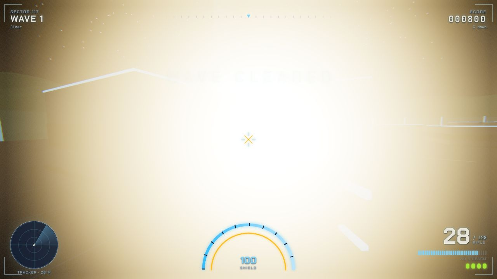

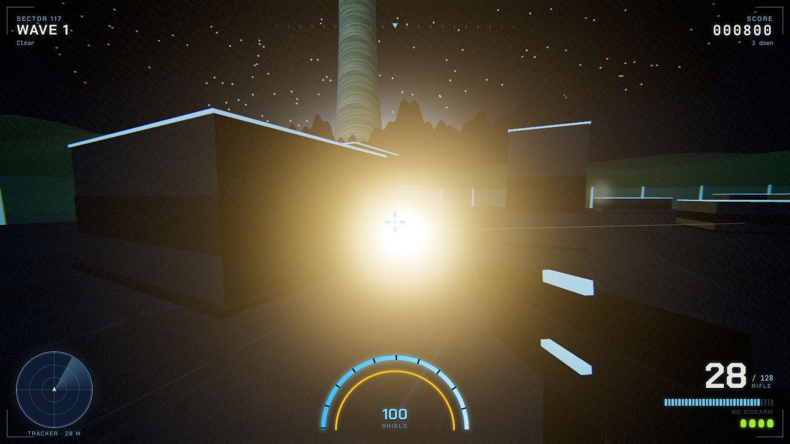

## 16:56 Weapons in hand

Stream B2's viewmodels integrated with the scene by the coach from the
agent's snippet; the agent had written against a copy of the scene
because stream A owned the file. The beam rig at night and the scatter
gun with a pickup column beside it, from the deterministic run at seed 7:

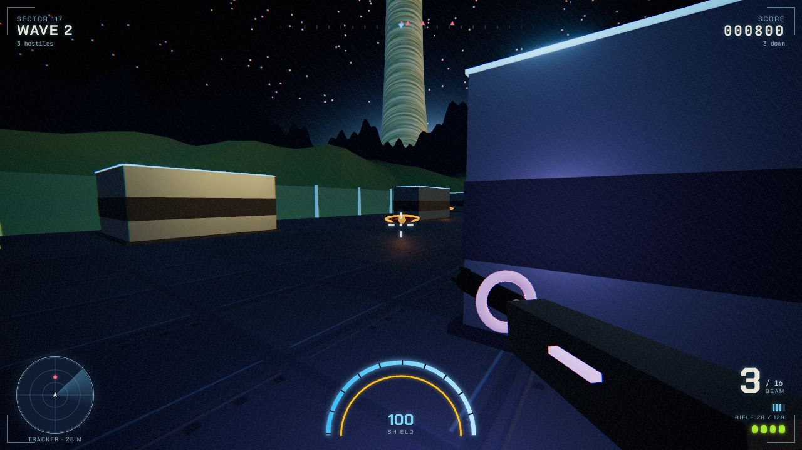

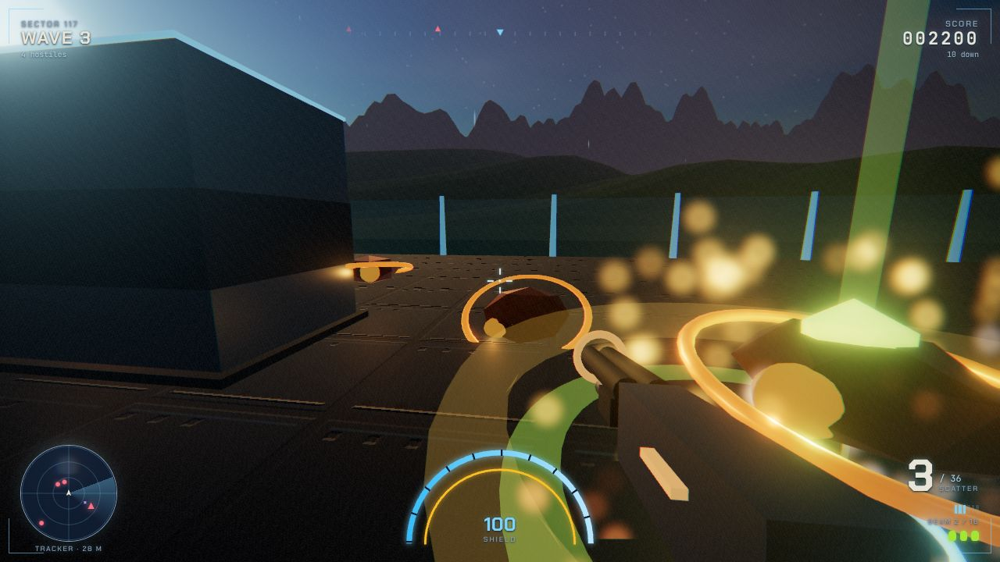

## 17:03 Three streams land

The three agent streams were landed by the coach in five commits on the
feature branch. b3ab847 `fix(render)` tamed the explosion and death flare
per the user's complaint: light 600 to 140, flash opacity 1.0 to 0.55,
bursts halved. 03c3f0f `feat(reel)` added the story-reel pipeline with
cards and day and night captures, cached and resumable. 0192cbb
`feat(weapons-render)` integrated stream B2's weapon viewmodels, tracers
and pickup emblems into the scene from the agent's own integration
snippet, and carried the real whiteout fix: the 64 px particle cap, the
near fade, dust kept 2.5 m from the eye, blasts scaled by distance.
d86c910 carried the docs for the atmosphere and weapon presentation, the
changelog and the journey. 627c55d renamed the journey frames to the
minute they were captured; the coach had first filed them under guessed
times, so the audit's warning about timestamps applied to the coach too.

Gates on the final tree: Biome and markdownlint clean, strict tsc clean,
90 unit tests with coverage thresholds, both Playwright smoke tests on
software GL in 1.7 minutes, and the build. Issue #24 was filed for the
one ugly moment left in the seed 7 run: the bot fires the launcher into
cover at its own feet at 48 s.

## 17:07 Merged before CI finished

The user asked for main to be merged "ASAP so other agents can PR off
main", and for more agents. PR #1 was taken out of draft and merged as
8566f27 with a merge commit, thirty commits kept, including two wip
checkpoints the stop hook had demanded. CI on the branch head was still
in progress at the time. The local gates on that exact tree had all
passed, and the push run on main is the check. The subscription to #1
was dropped.

The coach had been holding the PR as a draft until the reel landed. The
user wanted main unblocked first, and that was right, because thirteen
agents were about to branch from it. It is recorded in the overruled
list above.

## 17:08 The bloom problem, divided

The user's words after the reel were "lots of blooming and flare
issues". Two rounds of tuning lights had missed, because nobody had
measured a frame and the cause was the particle size law. So the work
was split by emitter, each issue owning its own file so the pull
requests cannot collide, plus a gate that measures:

- #25 the bloom pass and the sun flare (`post.ts`, the flare and
  lighting lines of `scene.ts`).
- #26 explosions and deaths (the spawn functions in `scene.ts`).
- #28 weapon flashes, beam and laser (`weapons.ts`).
- #29 pickup glow without per-pickup point lights (`pickups.ts`).
- #31 night, dust, rain, fog and enemy emissives after dark
  (`environment.ts`, the dust block, `enemies.ts`).
- #30 a luminance gate in CI: ten deterministic frames at seed 7 by day,
  night, dusk with rain and night with fog, with mean-luminance budgets
  (day 150, night 110 of 255) and a saturated-blob limit. The budgets
  are recorded from the frames at the commit they land on, not chosen
  to pass.

Seven more issues were dispatched alongside them, two new (#32, #33) and five from the backlog, outside the renderer: #32
core purity as a Biome rule instead of a grep, #33 one event-to-sound
table so the live bank and the offline score cannot drift, #24 the bot's
launcher, #12 the balance gate in CI with thresholds from the baseline
and a stated margin, #14 Easter eggs, #8 named wave beats, and #5
skimmers flee when a strider dies.

Thirteen cloud sessions were dispatched between 17:10 and 17:12, one per
issue. Each was briefed with the files it owns, the capture hook
(`?record&bot&seed=7` and `window.ringfallCapture`), the gates to run,
the PR template, and an instruction to message the coach's session with
the PR link and the measured numbers. The coach reviews and merges in
gate-first order: #32, #30 and #12 first, then the renderer PRs, then
core, merging main into each branch where `scene.ts` regions touch.

## 17:13 Three pull requests against an empty main

While the feature branch was still open, three bot PRs had been raised
from the issues between 16:53 and 16:55: #21 (the Claude GitHub app,
Easter eggs, #14), #22 (Copilot, the recording pipeline, #13) and #23
(Copilot, the third enemy archetype, #17). All three stopped themselves
with "game code not in repo", because main held nothing until 17:07.
They were closed with a note. Issue #13 was closed as already done on
main, issue #14 was re-dispatched from main, and #17 stays in the Later
epic.

Dependabot opened #27 (actions/upload-artifact 7.0.1 to 7.0.2,
SHA-pinned) at 17:08; it merges when its CI is green.

The lesson: an issue assigned to a repository bot runs against whatever
main holds at that minute. File the backlog before the merge, assign it
after.

## 17:13 Pickup glow without a light

Issue #29. Every pickup carried its own point light and a 3 m additive
column. Adding a light to a three.js scene changes the light count that
every lit material is compiled against, so the first pickup of a round
recompiled every shader (a hitch on real hardware), and the column
bloomed into a pillar that owned the frame from close up. The capture
hook at seed 7 shows the wave 3 reward land 5 m ahead at 41.9 s and the
bot walk into it by 42.5 s. The pickup is now an emissive emblem above
the bloom threshold, a billboard halo sprite, and a 2 m column whose
alpha falls off with the square of its height to zero at the top. A
Node test over the renderer counted zero lights under the pickup group
after a spawn, and the two take bursts dropped from sprite sizes 9 and
16 to 0.6 and 0.9, so a mote that has flown clear of the near fade stays
under the 64 px cap. Same frame, same tick, before and after:

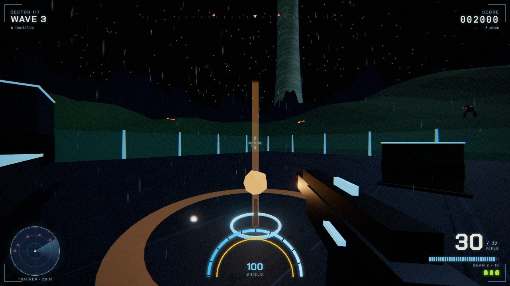

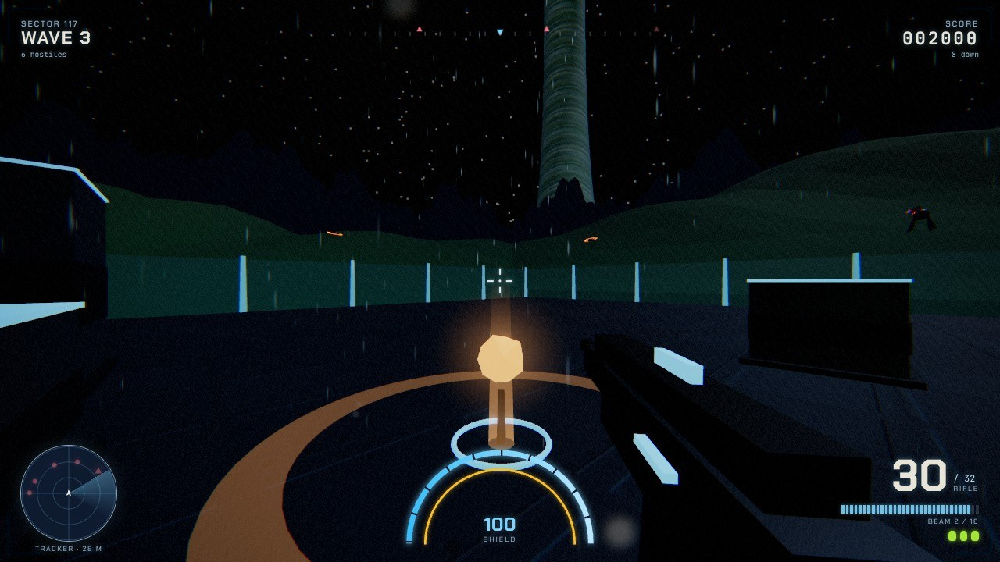

No pickup in the seed 7 run is ever seen from far away (rewards land 6 m
ahead and the bot walks into them), so the range check pushed a launcher
pickup into the live state through the `ringfall.state()` hook, 21 m
along the view at 43 s, night. It reads as a lime point on a post with
its plume, between the trims:

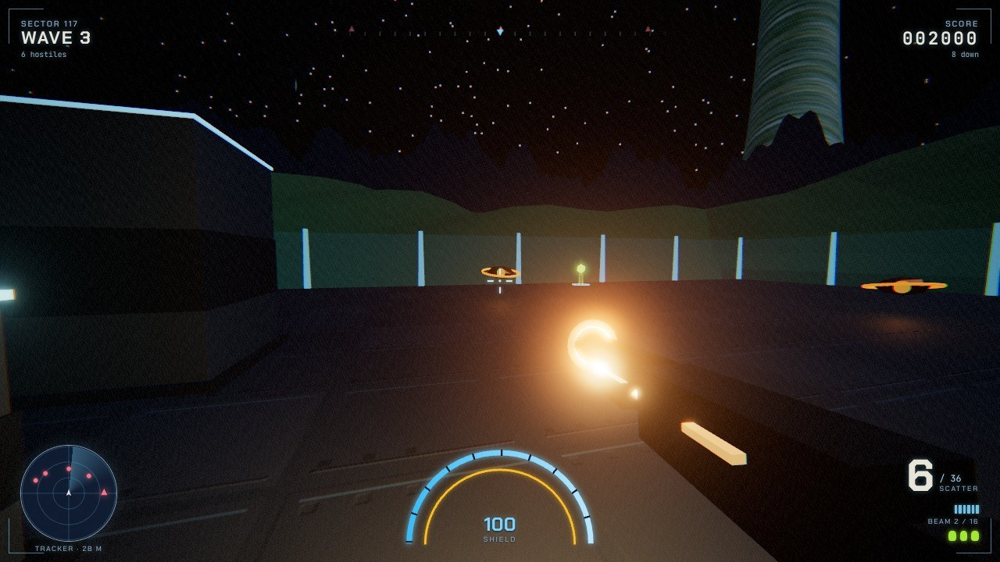

At 40 m, the far side of the arena, it is a lime point under the
reticle: findable, not loud. The 3 m column read further, and that was
the problem.

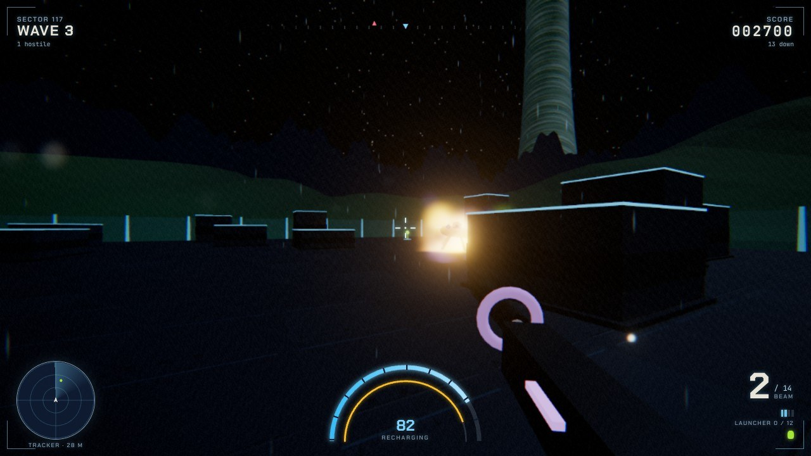

## 17:15 The reel, twice

The day-only interim cut (56.5 s, cards plus wave 1) was sent to the user
at 16:47 from a 16:11 build, so it still carried the old flare and the
dust discs. The night capture that was in flight was on the same old
build, so it was stopped at 17:04 and the full day-and-night cut was
restarted on the fixed build: cards cached, wave 1 and wave 2 recaptured,
score re-rendered, then the stitch. Capture runs at 1.6 to 2.5 s a frame
on this machine's software GL; the check-in to deliver it is set for
17:36.

The reel agent's shortfall list was honest and short: night unverified,
dust discs, and two browser deaths recovered by the resume logic.

## 17:26 A settings panel on the title card

Issue #37 asked for the four things a demo on a borrowed laptop needs:
mouse sensitivity, field of view, and switches for screen shake and the hit
flash, all kept between visits. The values live in a pure module,
`src/core/settings.ts`, modeled on the personal-bests store: missing,
blocked or corrupt storage yields the defaults, and the defaults are
exactly what the game did before the panel existed. The panel itself is a
collapsed "Settings" strip under the controls list so the title card stays
one button; opened, it shows two sliders and two checkboxes in the brand
tokens. Wiring stayed small: three one-line setters on the renderer (base
FOV, shake cap to zero, lattice off), one on the input controller, and a
body class that hides the HUD damage flash. The frame below was taken
headless from a clean profile with non-default values, after a reload, to
show the persistence working. The first capture showed the open card
overflowing an 800 px window and the field-of-view label wrapping; the
overlay now scrolls and the label column is wider.

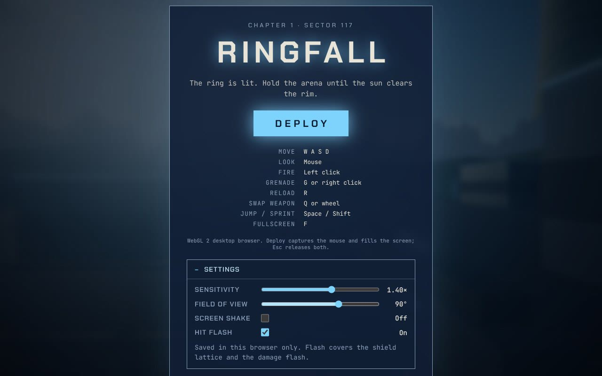

## 17:29 Brand compliance

The stylesheet had thirty-odd literal colors that predated the brand doc
(an `rgba` of Beacon here, a lime grenade pip there, a sky-blue hover
borrowed from a utility palette). Every one is now a token or a
`color-mix()` of a token, the shield arc gradient lost its two hex stops,
and the brand doc gained a type scale with a 14 px floor, because at 720p
the HUD unit is 3.24 px and "3.2 units" had quietly been a 10 px label.
Low ammo moved from Rose to Flare (the player's own state, per the
palette rule), and the title card and HUD got short entrance animations
with a reduced-motion opt-out. Checking the doc against the code turned
up the usual drift: the sun is `#ffe2b8` not `#ffc18d`, the hemisphere is
pale and green-grounded rather than the deep blue first proposed, the
sprint FOV approach is exponential rather than a 150 ms tween, and the
shake toggle does not exist. The doc now says what the code does and its
status moved from draft to approved. Frames: title and 10 s of seed 7,
before (`1724-*`) and after (`1729-*`), at 1280 by 720.

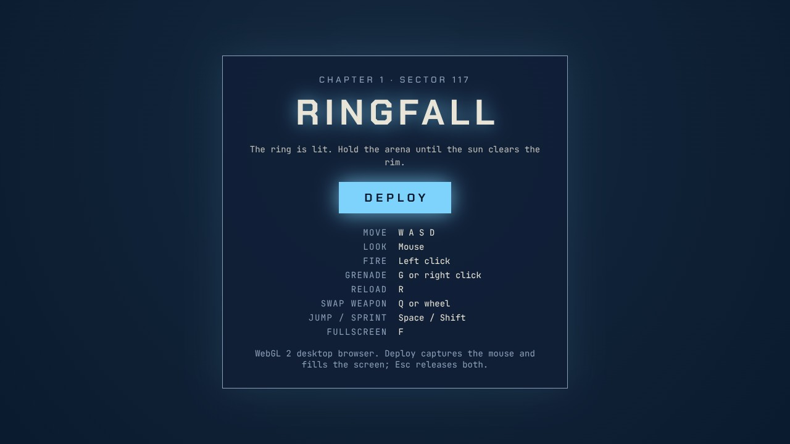

## 17:30 An explosion, not a glowing blob

Issue #26 asked for an explosion that reads at any distance and a frame
budget to prove it: mean luminance under 150 by day and 110 at night at a
grenade kill within 10 m, measured with the `?record&bot&seed=7&post` hook.
The timeline for seed 7 was pulled from the headless harness first (the
same seeds the browser uses), which put the useful moments at t = 9.95 s
(a skimmer kill 8.4 m away, by night the frame the earlier fix was judged
on), t = 46.95 s (a launcher round 3.0 m away that kills a skimmer at
1.9 m) and t = 47.92 s (a round at the player's own feet, the `near`
case). The old effect was a flash sphere, a flat disc and three big additive
bursts; the grey "smoke" burst added light to the frame because the pool
could only add. The pool now blends premultiplied alpha, which keeps the
spark path byte-for-byte and lets a `smoke` puff or a `shard` chip lay its
color over the frame instead. The explosion became five things on their
own clocks: a 120 ms sprite flash, a thin crest torus that flattens as it
expands, 32 sparks and 22 chips under gravity, a 56-puff column that rises
and thins over 1.5 s, and a scorch disc that holds for four seconds. A
kill now reads its colors off the rig that died: the light for the ring,
the shell for the debris. Two things were learned on the way: the 64 px
sprite cap means a smoke puff at 7 m is half a meter wide at most, so a
column needs count rather than size; and a torus scaled up to the blast
radius thickens its tube with it, so the crest tube is 22 mm at unit
radius. Frame means at 720p, HUD included, before and after, on a scale of
255:

| Moment (seed 7) | Day before | Day after | Night before | Night after |
| --------------- | ---------- | --------- | ------------ | ----------- |
| First kill, t = 10.0 s | 100 | 83 | 59 | 32 |
| Launcher kill at 3 m, t = 47.0 s | 119 | 106 | 121 | 101 |
| Peak over the 0.4 s after that kill | 125 | 128 | 121 | 105 |

The day peak after the kill is the bot turning towards the sun with the
shield lattice up; the same frame measured 125 before the change.

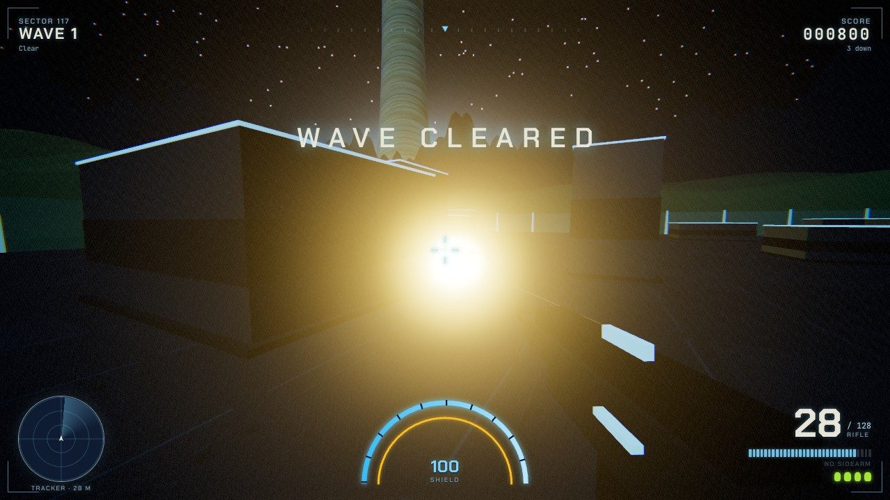

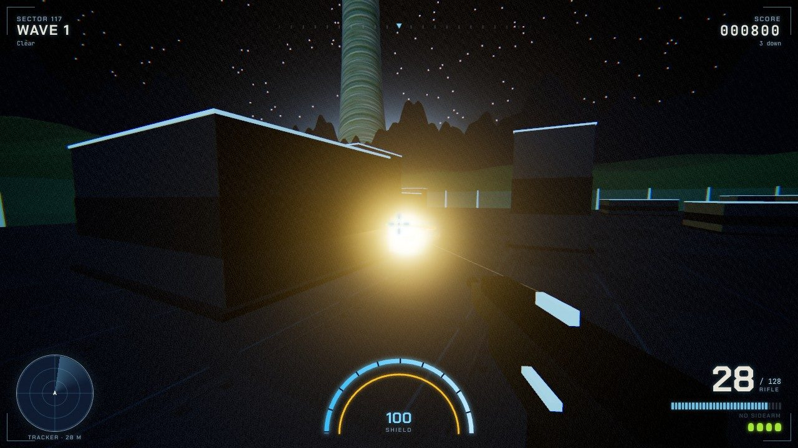

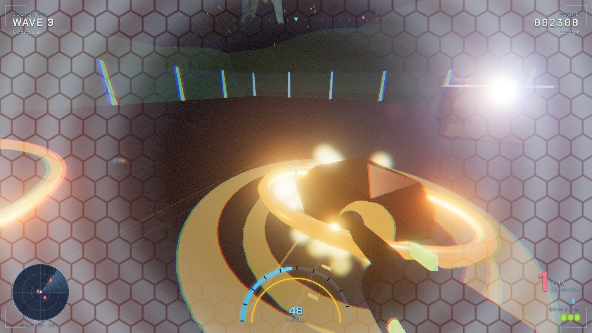

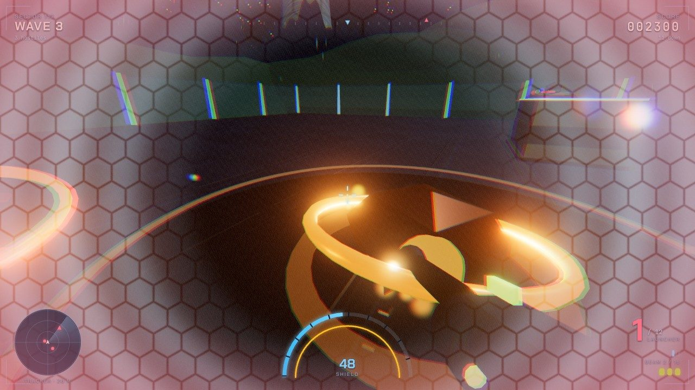

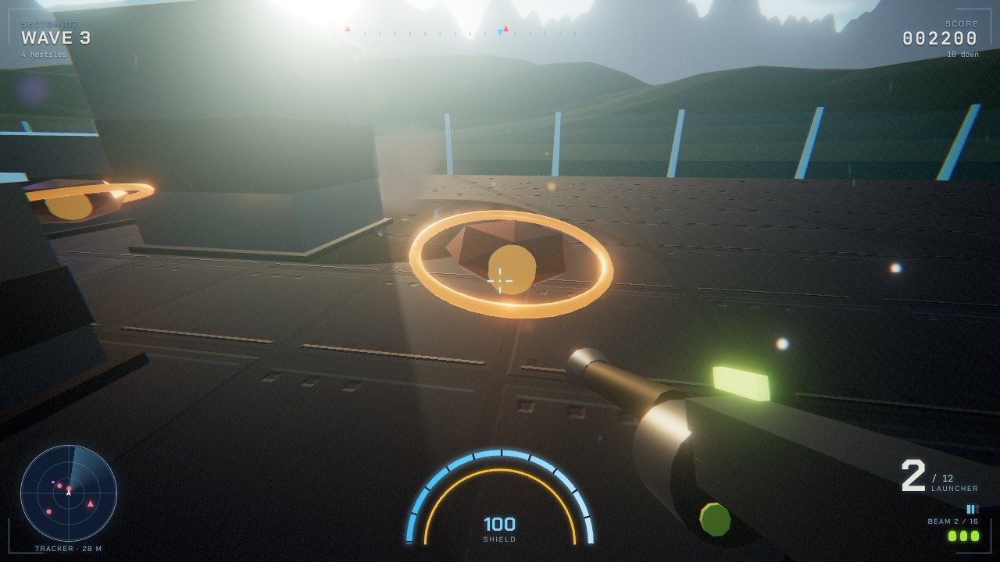

## 17:39 Weapon flashes under the HDR stack (issue #28)

The viewmodels had been tuned without bloom or the environment map, and
under the post stack the scatter's flash was a solid disc, the launcher's
near-camera smoke painted orange arcs over the lower third of the frame,
and the beam was a white bar. Rather than wait on wall-clock in a
software-GL browser, the shots were found first: a headless run of the
bot at seed 7 lists the tick of every `shot` event by kind (rifle at tick
263, beam at 1036, scatter at 2606, launcher at 2718, 2812 and 2874; the
laser and minigun never come up in that run, so seed 3 supplies them at
1443 and 3270). The capture hook then stepped straight to each tick and
rendered once, with the tick before and five ticks after for comparison.

What changed in `src/render/weapons.ts`: every flash sprite shrank (the
scatter from 0.52 m to 0.3 m, the beam from 0.48 m to 0.28 m) and the
table now carries a life in seconds instead of a decay rate, 35 to 75 ms,
so sprite and light are gone within 80 ms by construction; the muzzle
lights are a third to a half of what they were; the beam is a 3.5 cm white
core in a 14 cm sheath at 0.18 opacity with a 24 cd light instead of a
0.12 m cylinder at 0.55 with a 40 cd light; the laser is a 1.5 cm
cylinder instead of a 1 px line; the launcher's smoke moved a meter out,
past the particle shader's near-eye fade that had been turning it into
64 px motes on the lens, and it gained a muzzle ring that opens to 0.6 m.

Measured on the frames (connected region of pixels at or above 200/255
brightness around the muzzle, with the frame before the shot as the
control): the scatter's flash went from 331 px across to 133 px; the beam's
muzzle region from 291 px to 175 px, of which 142 px is the capacitor ring
that is lit in the control frame too; the rifle and minigun flashes no
longer reach 200/255 at all, so the test finds only the gun's own trims.
The launcher frame from seed 7 is the bot firing at a pickup under its own
feet, so the frame is dominated by the round and the pickup's emblem, not
the muzzle; the frame filed is from seed 3 at 50.9 s, where the bot fires
level. Frames, one per kind, from the deterministic runs:

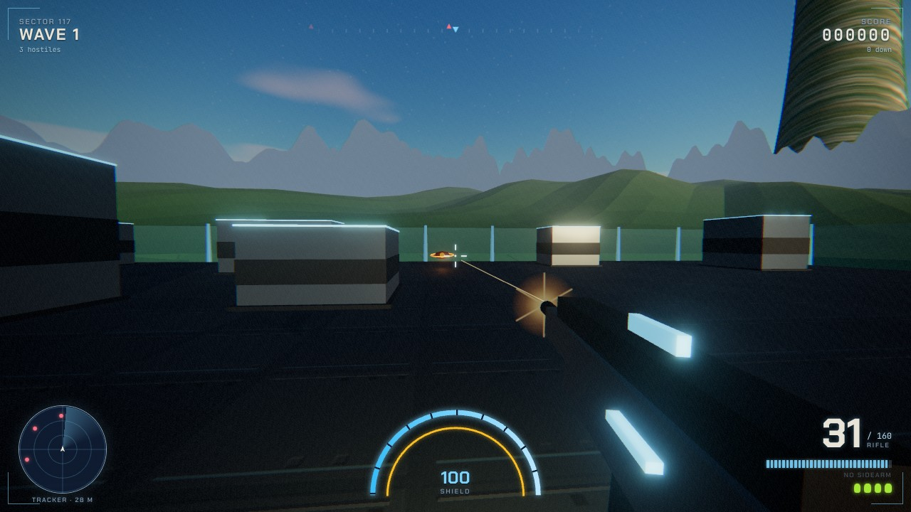

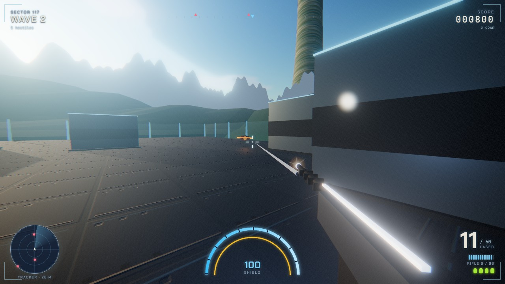

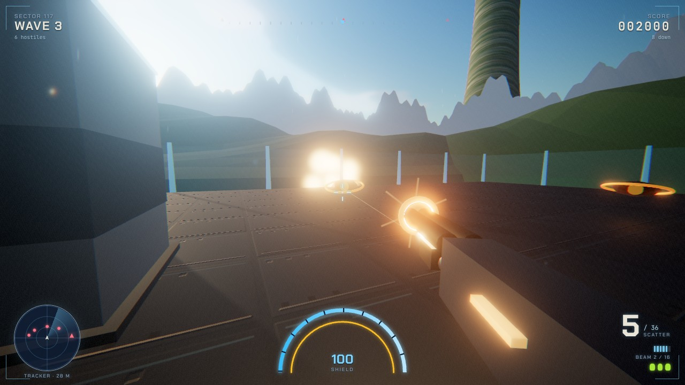

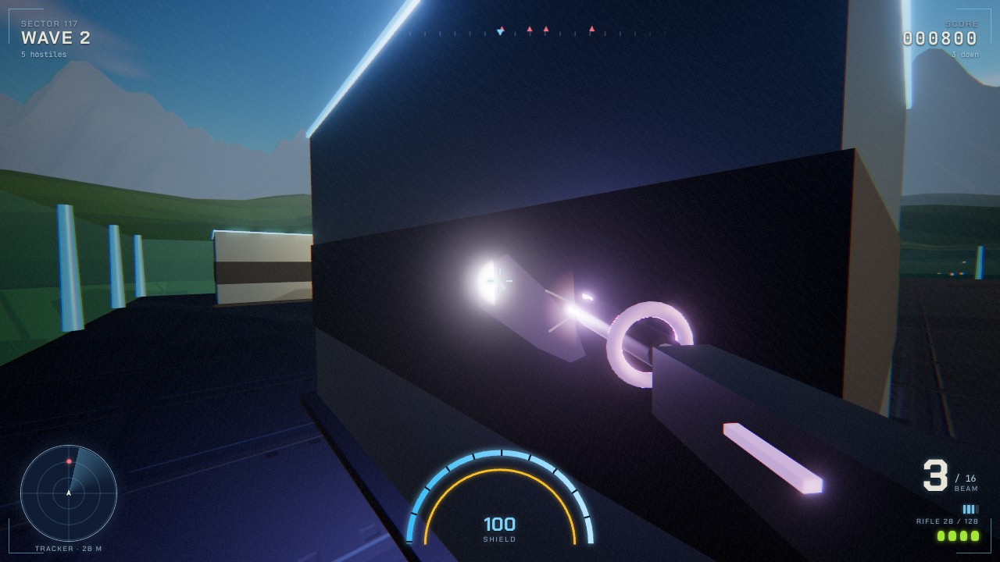

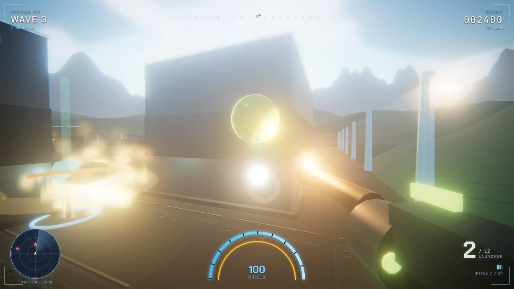

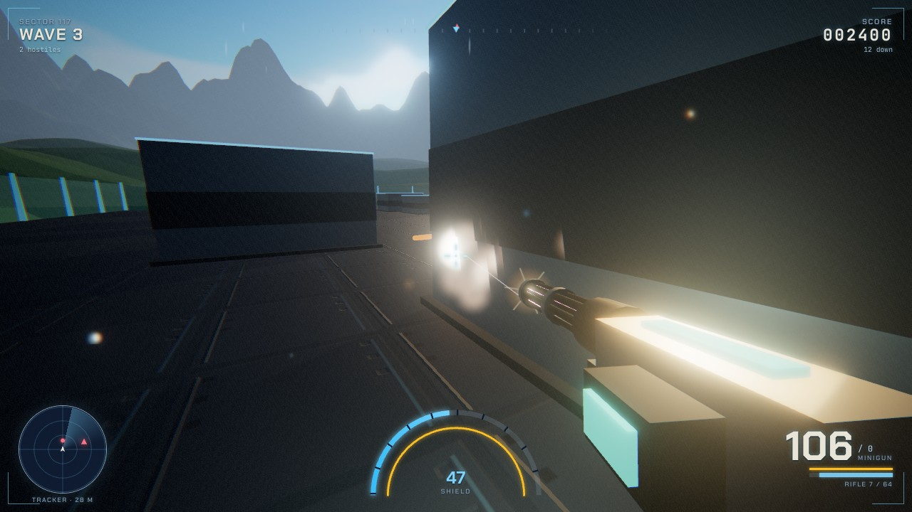

## 17:40 Bloom and flare pass, measured

Issue #25 asked for bloom numbers chosen from frames, not taste. Before
touching anything, seed 7 was stepped headlessly with the capture hook at
t = 4, 10 and 18 s by day and 8.5, 10 and 18 s at night, plus two frames
the bot never gives: standing still looking into the dawn sun, and pitched
up at the moon. Each frame was scored two ways: the mean luminance of a
64 by 36 area downscale, and the largest 4-connected blob of saturated
pixels (every channel at 245 or more). The sun-facing frame explained the
complaint on its own: a 354 by 158 px saturated blob, 22% of the frame
height, and a mean of 136. The cause was not the bloom strength but the
prefilter: `UnrealBloomPass` passes the whole HDR texel once it is over
the threshold, and the sky's sun disc is in the hundreds, so it bloomed
hundreds of times harder than a trim at 1.0; the dust motes, with their
center boost, did the same in miniature as fist-sized discs. The
prefilter now keeps only the excess over the threshold, with a quadratic
knee that starts at 1.0 and a cap of 1.5 per pixel, and the strength and
radius came down (0.35 to 0.3, 0.6 to 0.35). The flare ghosts, which
were already 5%, 8% and 3.5% of the frame height, are now sized as those
fractions explicitly and drawn at 0.6 opacity; core and ghosts are hidden
when `sunDisc` is 0. The moon's texel is under the threshold and was never
blooming: its 3 px disc carries a 6 px halo from its own sprite gradient,
unchanged. Every budget in the issue holds: no day frame over 150, no
night frame over 110.

| Frame (seed 7) | Mean before | Mean after | Saturated blob before | Saturated blob after |
| -------------- | ----------- | ---------- | --------------------- | -------------------- |
| Title (overlay up) | 41 | 38 | none | none |
| Day, 4 s | 105 | 86 | 188 by 168 px (23% of height) | none |
| Day, 10 s (kill flash) | 100 | 67 | 76 by 67 px (9%) | 56 by 38 px (5%) |
| Day, 18 s | 23 | 23 | none | none |
| Night, 8.5 s | 10 | 10 | none | none |
| Night, 10 s (kill flash) | 60 | 19 | 78 by 70 px (10%) | 58 by 43 px (6%) |
| Night, 18 s (beam) | 14 | 14 | none | none |
| Day, facing the sun, no bot | 136 | 106 | 354 by 158 px (22%) | 237 by 100 px (14%) |
| Night, facing the moon, no bot | 6 | 6 | none (disc 3 px, halo 6 px) | none (same) |

The 14% blob that remains when staring into the sun is the sky shader's
own forward-scattering aureole under ACES at exposure 0.38, not bloom;
it belongs to the environment rig and was left alone.

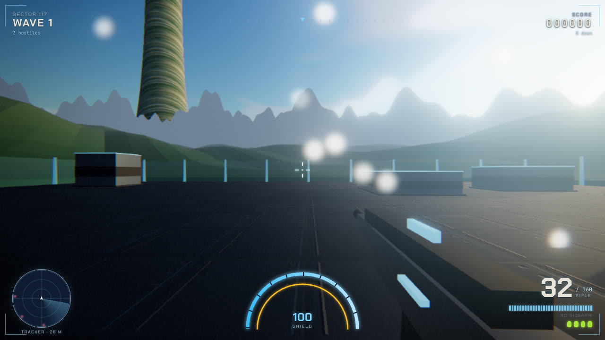

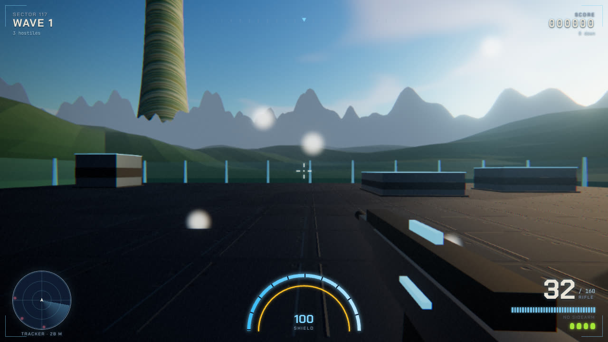

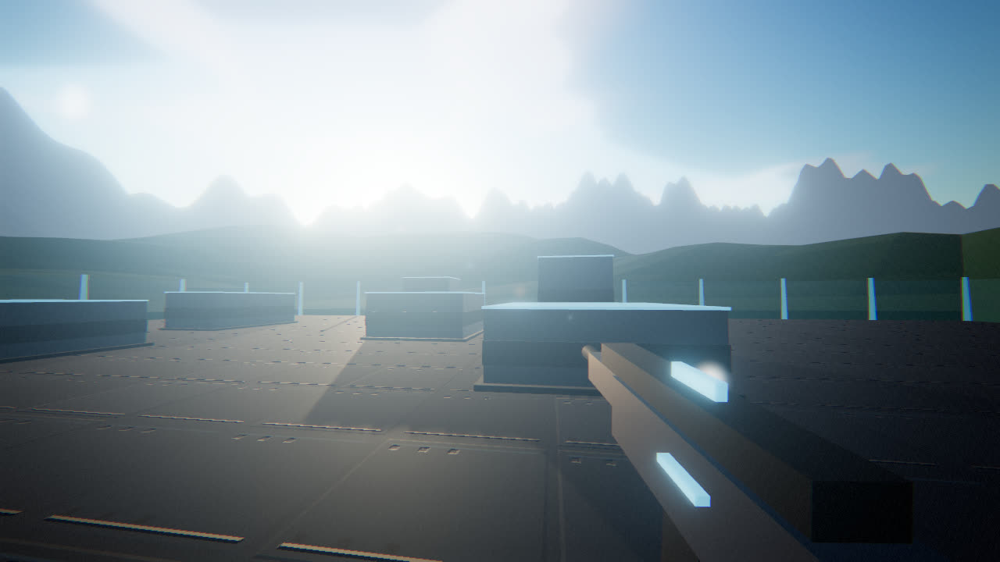

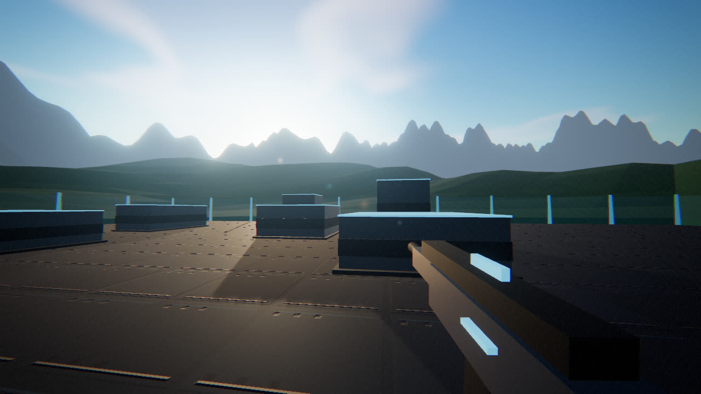

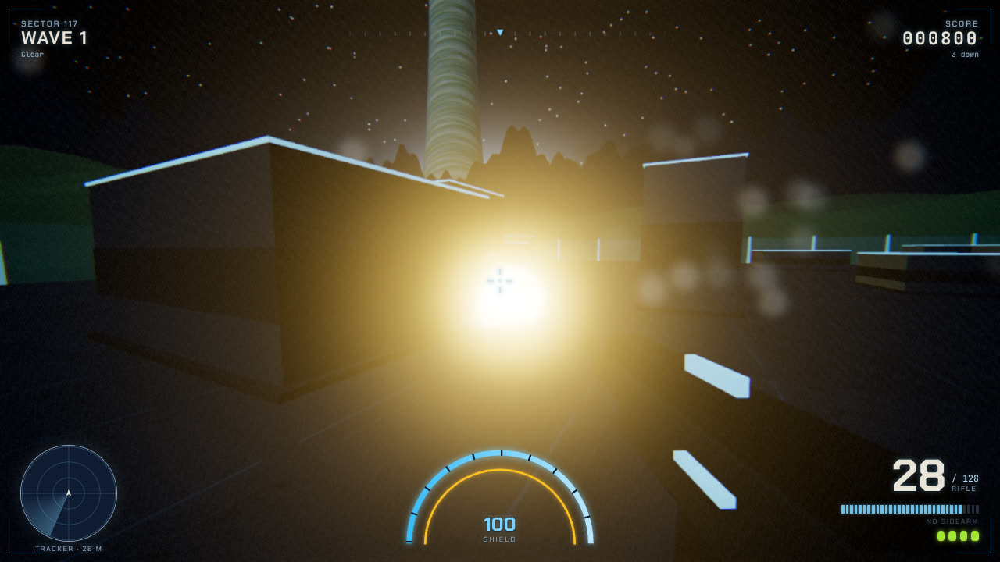

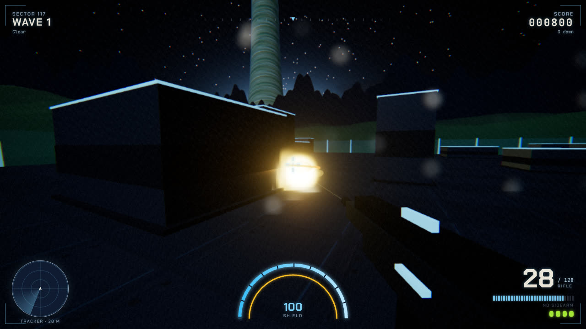

The remaining pairs (day 10 s and 18 s, night 8.5 s and 18 s, the moon)
are filed beside them as `1715-bloom-before-*.jpg` and
`1740-bloom-after-*.jpg`.

## 17:40 The hero is a frame, not a drawing

Seven moments of seed 7 were rendered headless at 3840x1600 with the post
stack on and the HUD hidden (new `?nohud` dev flag): night at 10 s and 18 s,
dawn at 2 s and 95 s, day at 10 s, dusk at 45 s, rain at 18 s. About 30 s a
frame on software GL. The night kill at 10 s won the banner: dark sky for
the wordmark, a warm skimmer burst between the slabs, the ring overhead.
Dawn 95 s (sun flare), night 18 s (beam) and dusk 45 s (laser) make the
README strip. The contact sheet is `images/1740-hero-contact.jpg`; the
recipe is the "Hero and social" section of `docs/brand.md`.

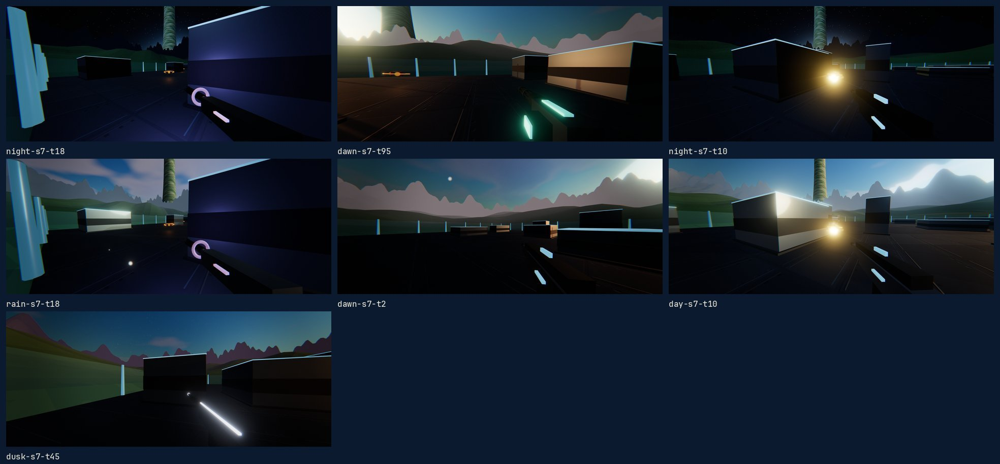

## 17:50 The watcher, held at the gate

Issue #17's third archetype went in as new files (`src/core/watcher.ts`,
`src/render/watcher-rig.ts`) with one dispatch line in the enemy module, so
it could land beside the agents splitting `updateEnemy`, rewriting the wave
table and adding night emissives. The state machine, the cover-blocked
beam, the rig's aspect ratio and the kill-time step are unit-tested. The
balance gate is where it stopped: with one watcher from wave 5 the steady
bot cleared 4.25 waves and won 5 % against floors of 4.85 and 10 %. Three
bot rules (do not chase a unit that backs off, finish an engaged watcher,
draw a precise gun and wait for the reticle) and a 3.5 s cooldown brought
it to 4.55 to 4.80 waves and 0 to 5 % wins, still under the floor, so the
roster entry shipped behind `WATCHERS_IN_ROSTER = false` with the tables
in the pull request. The wave 5 frame was not captured: the record-mode bot
on seed 7 was still in wave 3 at 394 s on this machine's software GL, and
the hard stop came first. Next update: set by whoever takes the balance
pass.

## 18:08 Flare budget, second cut

Issue #71: after #61 the user watched the reel twice and said there was
still far too much flare. The same frame set was measured the same way
(mean luminance of a 64 by 36 downscale; largest 4-connected blob of
pixels with every channel at 245 or more) before and after, at 1280 by
720 with seed 7. Bloom strength went from 0.3 to 0.15 and radius from
0.35 to 0.25; the flare ghosts from 0.6 to 0.3 opacity and the core sprite
to two thirds of its size (520 to 347); the day and dawn skies got a
thinner, tighter mie lobe (coefficient 0.003 to 0.0008 and 0.006 to 0.002,
g 0.82 to 0.93 and 0.85 to 0.92), which is what the aureole was. The night
rig, the dust block and the explosions were not touched. The facing-the-sun
blob fell from 13% of the frame height to 3%; the means moved little
because they are sky and terrain brightness, not flare, and the night kill
frame is the explosion from #60, which this cut does not own. The ring,
trims and stars are still visible at night on the frames.

| Frame (seed 7) | Mean before | Mean after | Saturated blob before | Saturated blob after |
| -------------- | ----------- | ---------- | --------------------- | -------------------- |
| Title (overlay up) | 43 | 42 | none | none |
| Day, 4 s | 84 | 78 | none | none |
| Day, 10 s (kill flash) | 55 | 56 | none | none |
| Night, 10 s (kill flash) | 40 | 37 | none | none |
| Night, 18 s (beam) | 24 | 23 | none | none |
| Day, facing the sun, no bot | 114 | 106 | 206 by 95 px (13%) | 28 by 24 px (3%) |

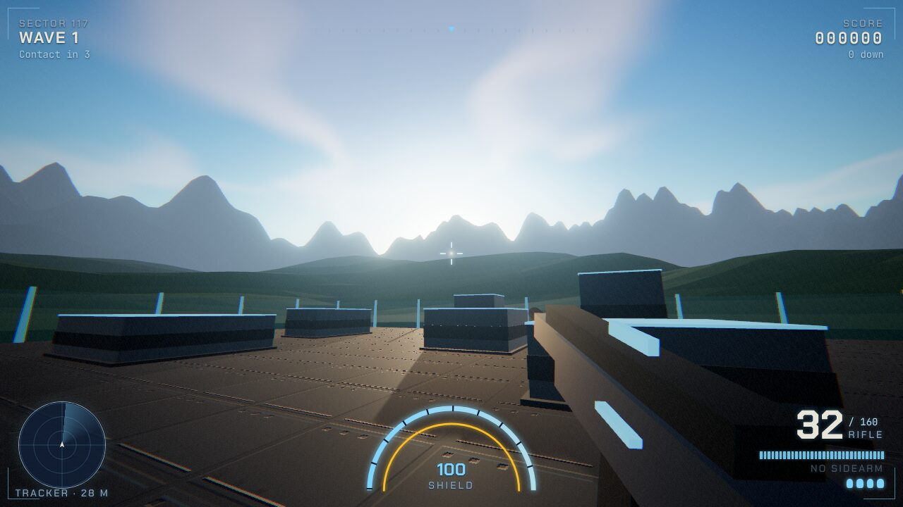

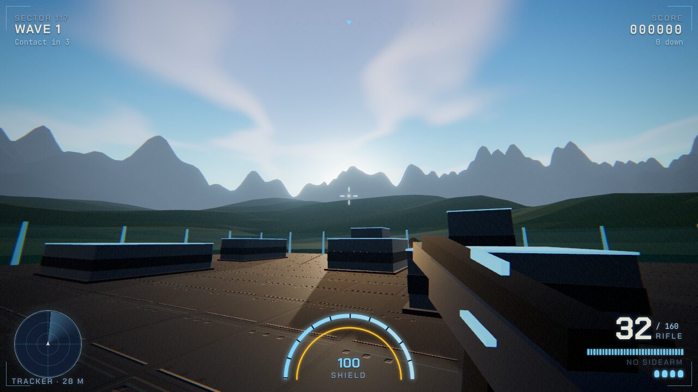

The other pairs are filed beside them as `1803-flare2-before-*.jpg` and
`1808-flare2-after-*.jpg`.

## 18:10 Freeze: what four hours built

The hard stop was 18:30 UTC. At 18:10 the counts, taken from the
repository and GitHub rather than from memory, were these. Earlier
entries and the deck quoted smaller numbers because they were written
while the numbers were still moving; this entry supersedes them.

| Measure | Count at 18:10 |
| ------- | -------------- |
| Elapsed since kick-off | 4 h 2 min |
| Commits on main | 162 |
| Pull requests merged | 29 |
| Issues filed | 51 (26 open, 25 closed) |
| Cloud sessions dispatched | 30 |
| Local subagents (research, product docs, audit, streams, journal, deck, reel) | about 15 |
| Unit tests on main | 278, all passing |
| CI jobs on every pull request | lint and types, unit, browser smoke, build, balance gate, frames gate, docs hygiene, security and workflow hygiene |

What the second coaching round changed, in order of what a player sees:
the bloom prefilter and a second flare cut; explosions rebuilt as flash,
crest, debris, smoke and scorch; weapon flashes sized to the frame;
pickups without point lights; a settings panel with shake and flash
switches; skimmers that rout when their strider dies, with a squeal; four
skimmer temperaments, a crouch and a hidden switch; the watcher archetype
built and tested but shipped behind a roster flag because six variants
failed the balance gate; the hero banner and social card rendered from
the game; every self-reference pointed at the new repository name; the
franchise name removed from everything but citations. Underneath: a
purity lint rule, a design-doc numbers test, a balance gate, a luminance
gate, Vale, typos, link checks and a frontmatter schema, actionlint,
zizmor, gitleaks, npm audit and Stylelint, a strict Content Security
Policy, and two adversarial reviews (software: 40 findings, 19 fixed;
documentation: 70 findings, 56 fixed, verdict unchanged at two and a half
of five).

What did not make the stop: the five named wave beats and the dropship
that rides on them, the design and user-experience review's fixes, the
threat model and the architecture package, all open as pull requests or
sessions at the freeze. Two admin items need the owner: GitHub Pages is
not enabled, so nothing has deployed to the custom domain yet, and main
has no branch protection.

The coaching lesson of the afternoon, counted: twenty-nine merges in
seventy minutes meant almost every pull request conflicted with the one
before it, nearly always in the changelog, the journal and the design
doc, because every agent was told to document in the same three files.
Next time the brief gives each stream its own journal page and the
changelog is assembled at the freeze.

## Playtest reviews

Each row is a human or agent watching the game play, not a screenshot.

| When | Seed | What was watched | Verdict |
| ---- | ---- | ---------------- | ------- |
| 17:30 | 7 | The first kill at night (t = 10 s), the launcher kill at 3 m (t = 47 s) and a blast in the open (t = 45.5 s), by day and by night, at 50 ms steps, after the explosion rework | The crest reads as a pressure wave from 3 m and from 19 m (an arc on the floor past the cover); chips and sparks fall where the eye expects them; the smoke column shows by day and against lit walls at night, and is invisible against the night sky, which is right for soot. The scorch is the one thing that is still there a second later. The frame at the first kill is still dominated by the dying skimmer's own core and light, not by the kill effect. |
| 17:00 | 7 | A 75 s bot run by day, frames every 3 s, and the night kill at 10 s, after the weapon integration | Weapon swaps read (beam at 18 s, scatter at 45 s, launcher at 48 s), pickup columns are visible from across the arena, the night frame keeps its stars and trims. The launcher round the bot fired at its own feet at 48 s still washes the frame pink with the shield-down effect; that is the jolt it should be, but the bot should not do it (issue for the bot: no launcher inside the blast radius). |
| 15:56 | 7 | The whole 49 s film with its offline score: title, deploy, waves 1 to 4 | Reviewed frame-by-frame at 8 s, 22 s and 46 s and watched end to end at speed: the sun flare and bloom carry the opening, the bot's first kill lands at 4.8 s, wave 2 brings the first strider and bolts, the HUD reads at 720p. Weak points: around 8 s the bot turns into the sun and the frame whites out for about two seconds (this capture predates the exposure and haze reduction and HUD v2), and the bot stands in the open while reloading. Shipped as the first reel; a second capture with the current build was started at 16:00. |
| 15:29 | 7 | Frames 100 to 225 of the first capture (wave 1, 24 fps) | Bot kills two skimmers by 8 s, loses the third behind cover and reloads in the open; the sun behind a slab blooms hard enough to hide the reticle for a second. Readable, dramatic, slightly over-bright. Exposure left as is for the reel; a bloom radius reduction is a candidate. |

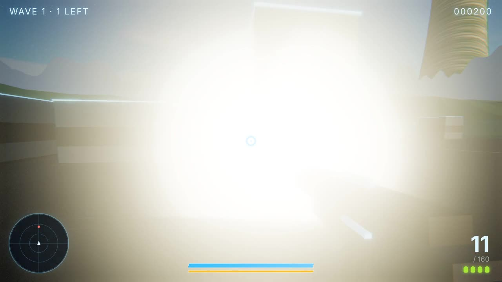

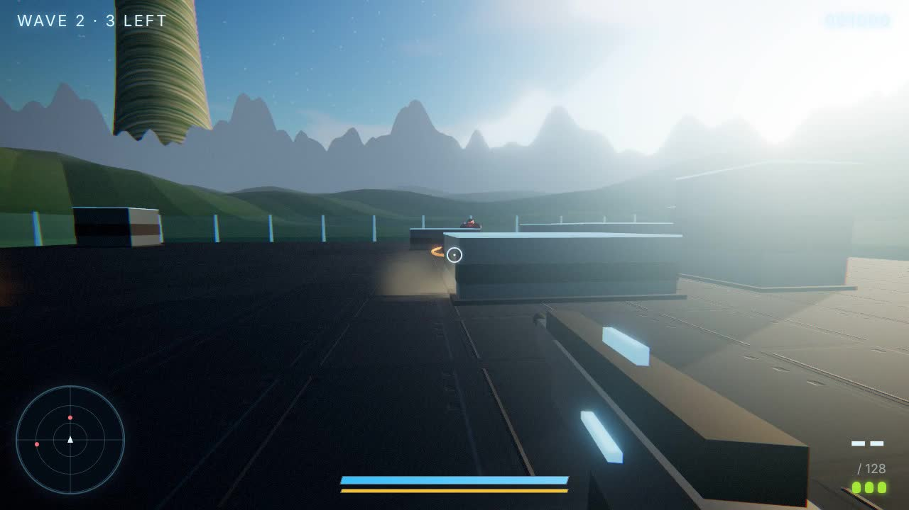

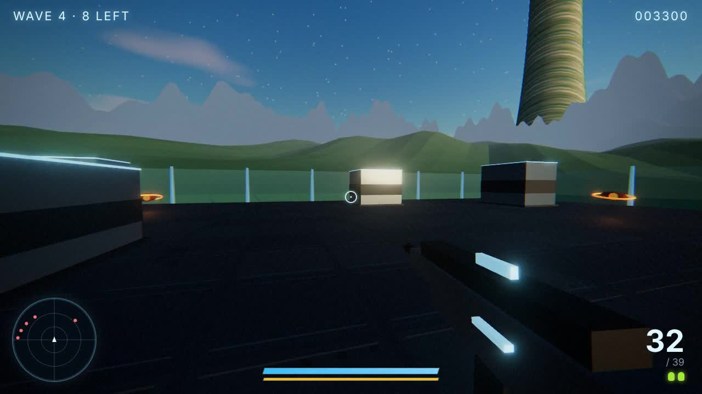

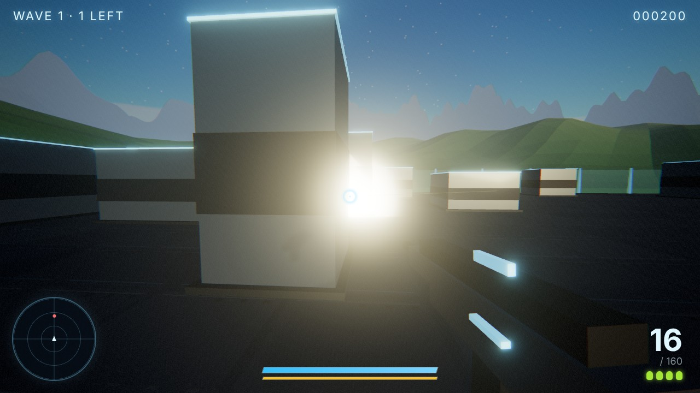

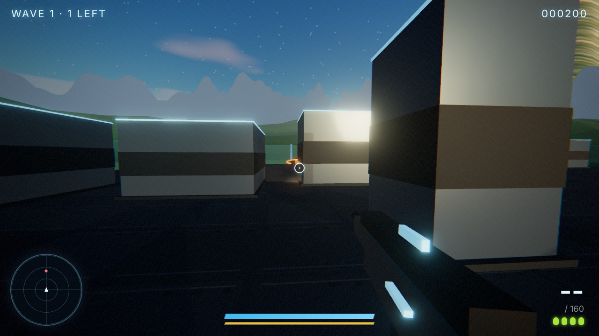
