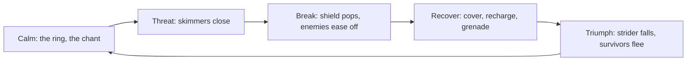

# Ringfall Chapter 1 storyboard

> [Ringfall](../../README.md) > [Specification](../spec.md) > Storyboard

This is the demo as a sequence of moments. It adapts the shot list in the
feel research note under [research/](../research/) to what Ringfall has: a
live scene behind the title, a Deploy button, a three second countdown,
and a first wave of three skimmers. Timings and damage values come from
[design-doc.md](../design-doc.md); motion values from
[brand.md](../brand.md). Beats marked as MLP items are not all built yet;
[spec.md](../spec.md) holds their status.

## The emotional arc

The loop runs once per wave and closes on the tableau, where triumph
settles back into calm.

## The first thirty seconds

| t | sees | hears | does/feels |
| - | ---- | ----- | ---------- |
| 0 to 1 s | The live arena behind a blurred overlay fades up. | Silence, then the chant's first phrase. | Waits. |
| 1 to 3 s | "RINGFALL" letters slide and lock in. | The drone settles on its D minor pedal. | Reads the one line of copy. |
| 3 to 5 s | Trim lines across the cover slabs ignite. The Deploy button draws its border and breathes. | Second phrase. | Finds the controls hint bottom-right. |
| 5 to 6 s | Clicks Deploy. The blur drops, the mouse locks, HUD panels slide in with a stagger. | Shield-recharge sting; combat bus armed, silent. | "Oh, nice." |
| 6 to 9 s | "WAVE 1" with the three second countdown. The sun sits low behind the ring. | Chant continues; a low string drone joins. | Looks up. This is the screenshot. |
| 9 to 10 s | Three skimmers descend from six metres on the 26 m ring, invulnerable for one second. | Drop impacts. | Raises the rifle; one test shot shows kick, tracer and muzzle light. |
| 10 to 14 s | Skimmers close at 7 m/s with lateral jitter, fanning out. | Hover whine rising. | Picks one; first hit flashes it. |
| 14 to 15 s | Second shot. First kill: 50 ms hit-stop, squash and tilt, kill ring, sparks, plus 100. | Kill chime, first drum. | Grins. |
| 15 to 22 s | Two skimmers reach 2 m and zap for 12 every 0.9 s. The hex lattice flares on each hit. | Glassy FM shield hits. | Strafes and kills the second. |
| 22 to 26 s | The last skimmer keeps contact; the shield bar is low and the border pulses. | Shield warning. | Backs off behind a slab. |
| 26 to 30 s | First grenade bounces off the floor and lands at the skimmer. Blast, kill, "WAVE CLEARED", plus 500. | Thud, explosion, clear stinger. | Breathes during the 2.5 s pause. |

## One beat per wave

The composition per wave is the first five rows of the roster in
design-doc.md. The names and the pacing windows come from the research
note; the beats are the MLP items that make each wave different.

| t | sees | hears | does/feels |
| - | ---- | ----- | ---------- |
| 0:30 to 1:30, Scouts | Three skimmers. The player learns two shots per kill and the shield recharge. | Calm bus, percussion stinger on the first kill. | Confidence. |
| 1:30 to 2:45, The Leader | Four skimmers and the first strider, which lands last with an idle posture (MLP 8). Its lens goes white before each bolt. When it dies, every skimmer flees with a bark (MLP 3). | Horn stinger on the strider; a bark on the flee. | "They noticed." The first spectacle, before minute three. |
| 2:45 to 4:30, Fallback | Five skimmers and a strider that takes firing points behind cover (MLP 5) and falls back when pushed. | Combat bus full; the chant drops out. | Patience; the player hunts rather than holds. |
| 4:30 to 6:30, The Push | Six skimmers and two striders. The first bounced grenade sees a strider dive (MLP 4). The shield breaks at least once, the enemies ease off (MLP 1). | Chant returns under percussion. | "It let me breathe." |
| 6:30 to 8:00, Last Stand | Seven skimmers and two striders. The player is low on grenades and health never came back. | Everything in the mix. | Stakes. |

## The victory tableau

| t | sees | hears | does/feels |
| - | ---- | ----- | ---------- |
| 0 s | The last strider dies: 90 ms hit-stop, squash and tilt, kill ring. | Strider death chime. | Relief. |
| 0 to 1.2 s | Surviving skimmers flee outward as the corpse despawns. | Barks fading. | "I did that." |
| 1.2 to 3 s | The HUD tweens out. The camera tilts up to the ring, sun behind it. | Combat bus ramps down; the chant resolves. | Stillness. |
| 3 to 6 s | The wordmark and the final score settle over the ring. No menu. | The drone holds. | The image and the sound, nothing else. |

## The 45 second demo reel

The reel is cut from the seeded recording described in
[test-plan.md](../test-plan.md), so every shot is reproducible.

| t | sees | hears | does/feels |
| - | ---- | ----- | ---------- |
| 0:00 to 0:04 | Blurred arena, wordmark locking in. | First chant phrase. | Curiosity. |
| 0:04 to 0:08 | Deploy click, HUD stagger, countdown. | Recharge sting. | Anticipation. |
| 0:08 to 0:14 | Tilt up: the ring crossing the dawn sky. | String drone. | Awe. |
| 0:14 to 0:20 | First kill, tracer, hit-stop, kill ring. | Kill chime, first drum. | "The gun feels good." |
| 0:20 to 0:27 | Shield breaks: flare, vignette, enemies back off; cover, recharge. | Sweep down, then the rising recharge tone. | "It let me breathe." |
| 0:27 to 0:33 | A grenade bounces round a slab; a strider dives. | Thud, blast. | "It dodged my grenade." |
| 0:33 to 0:39 | The strider falls; skimmers scatter. | Horn, barks. | "They noticed." |
| 0:39 to 0:45 | Tableau: tilt to the ring, wordmark, score. | The chant resolves and holds. | Wanting to play it. |
