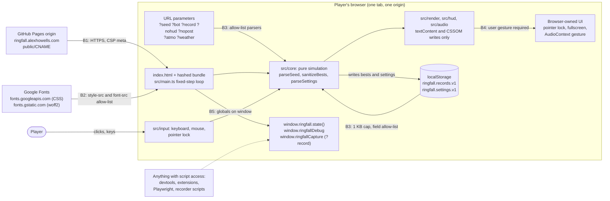
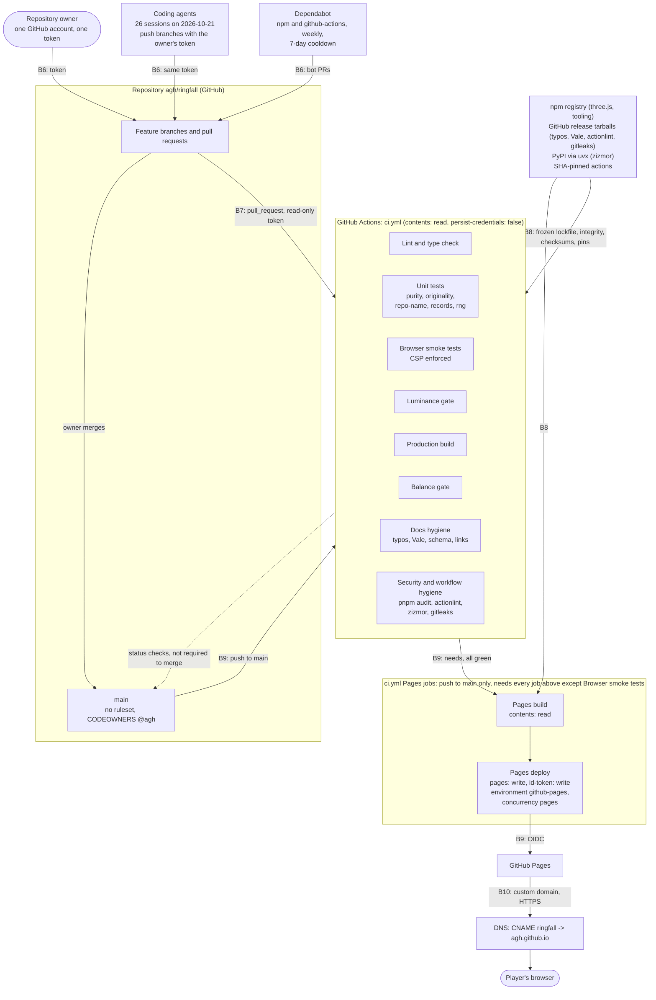
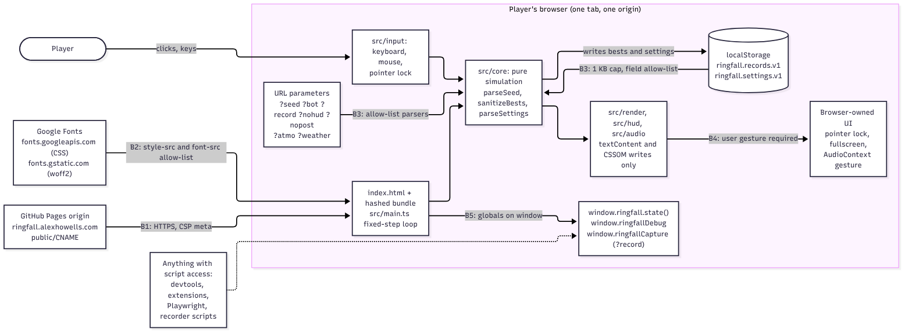
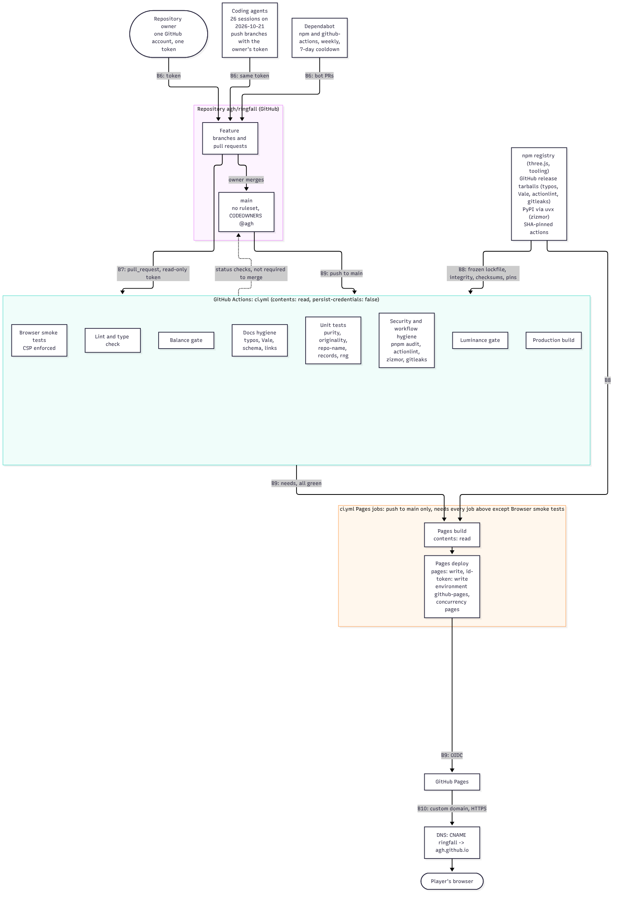

# Ringfall threat model

> [Ringfall](../README.md) > [Specification](spec.md) > Threat model

This document is the maintained form of the security review on issue #52
and pull request #68. It names what is worth protecting, draws the two
systems that touch it (the running game and the chain that delivers it),
and lists every threat per trust boundary with the control that exists in
the tree today, the gap if there is one, and the issue that tracks the gap.
Every control is cited by file path as of `main` at `6fb2608`
(2026-10-21). Where a row says "Fn", it means finding n in the ranked
checklist on #52, applied by #68; the index at the end lists all 22 with
their current status.

[SECURITY.md](../SECURITY.md) keeps the ten-line summary and the reporting
path. [risks.md](risks.md) carries product and delivery risks; row R11
there points here. The launch checklist in
[launch-checklist.md](launch-checklist.md) asks that this document has been
re-read before a tag.

## 1. System and trust boundaries

Boundaries are numbered B1 to B10 and the same numbers are used in the
threat tables. A boundary is a place where data or authority crosses from
one party to another, and every one of them is where a control has to sit.
The diagrams are Mermaid source in this file; the PNG files under
[diagrams/](diagrams/) are produced from these blocks (see
"How to update this document").

### 1.1 The running game



| Boundary | From | To | What crosses | Why it is a boundary |
| -------- | ---- | -- | ------------- | -------------------- |
| B1 | GitHub Pages at the custom domain | the player's browser | the static build: `index.html`, hashed assets, `CNAME` | integrity of what is served depends on TLS, DNS and the Pages configuration, none of which is in this tree |
| B2 | Google Fonts (two hosts) | the page | one stylesheet and the `woff2` files it names | a third-party origin inside the page; it learns the player's IP address and can inject CSS |
| B3 | the query string and local storage | `src/core` parsers | `?seed`, `?bot`, `?record`, `?nohud`, `?nopost`, `?atmo`, `?weather`; `ringfall.records.v1`, `ringfall.settings.v1` | the only untrusted input the page reads; anything the player, a share link or an extension wrote |
| B4 | the page | browser-owned UI | pointer lock, fullscreen, audio unlock | the page asks for capabilities that can trap or annoy the player; the browser decides |
| B5 | the page | anything with script access to the page | `window.ringfall`, `window.ringfallDebug`, `window.ringfallCapture` | the debug surface is readable by devtools, extensions and the test harness; nothing else can reach it cross-origin |

### 1.2 The delivery chain



| Boundary | From | To | What crosses | Why it is a boundary |
| -------- | ---- | -- | ------------- | -------------------- |
| B6 | the owner, the agents the owner runs, Dependabot | the repository | commits and pull requests | twenty-six agent sessions pushed with one token in one afternoon; the repository has no rules about what a token may do to `main` |
| B7 | the repository | GitHub Actions runners | workflow files, the `GITHUB_TOKEN`, third-party actions | a pull request runs third-party code from `node_modules` on a runner holding a token |
| B8 | npm, PyPI, GitHub releases, the actions marketplace | the runner and the developer's machine | packages, binaries, actions | the build runs whatever those hosts serve; pins and checksums are the only defense |
| B9 | `main` | GitHub Pages | the built `dist/` through an OIDC deployment, from the `pages-build` and `pages-deploy` jobs at the end of `ci.yml` | the one write path to the site |
| B10 | GitHub Pages | DNS and the player | the custom domain `ringfall.alexhowells.com` | a dangling or wrongly set record points players somewhere else |

## 2. Assets

| Asset | Worth protecting to | What losing it looks like |
| ----- | ------------------- | ------------------------- |
| The player's browser session: a tab that runs a trusted-origin script with pointer lock and fullscreen granted | the player | a script injected through the page runs with the page's origin; the page traps the cursor or the screen; the player's address and habits leak to a third party |
| Personal bests and settings in local storage | the player | a corrupted or oversized value stalls the end card or silently resets a record |
| The owner's GitHub account and the repository, including `main` and its history | the owner | a bad commit lands on `main`, a token is published, history is rewritten, a secret or a franchise term ships |
| The domain `ringfall.alexhowells.com` and the Pages site | the owner and every player | players are served a different site, or nothing |
| The integrity of what is served: the bundle at the domain is the bundle `main` built | the owner and every player | a hijacked dependency, action or Pages deployment changes the code players run |
| The honesty of the demo, the frames and the balance records | the owner, judges, reviewers | a film or a number describes a build other than the one in the tree |

There are no accounts, no server, no secrets in the repository, no
leaderboard and no payment. That is what keeps most rows below at low
impact, and it is also why the agent-built supply chain is the boundary
with the most to lose.

## 3. Threats by boundary

Each row is one threat, classified with STRIDE (Spoofing, Tampering,
Repudiation, Information disclosure, Denial of service, Elevation of
privilege). Likelihood and impact are low, medium or high on the same
three-point scale as [risks.md](risks.md). "Control today" cites the file
that implements it at `6fb2608`; "Gap" is what the control does not cover;
"Issue" is where the gap is tracked. A row with no gap has no issue.

### 3.1 Running game: B1 to B5

| ID | Boundary | STRIDE | Threat | Likelihood | Impact | Control today (file, finding) | Gap | Issue |
| -- | -------- | ------ | ------ | ---------- | ------ | ----------------------------- | --- | ----- |
| T1 | B1, B10 | Spoofing, Tampering | The domain or the Pages site serves something other than the build from `main`: a DNS `CNAME` created before Pages is enabled and the domain verified can be claimed by another Pages site; HTTPS not enforced lets a network attacker rewrite the page. | Low | High | `public/CNAME` pins the hostname into every deploy; `vite.config.ts` content-hashes every asset; `docs/runbook.md` "Custom domain" gives the order of operations. As of 2026-10-21 Pages serves the branch source (the raw `index.html`) over HTTP, the DNS record exists and HTTPS is not enforced (F1; #54 finding 17; `docs/runbook.md`). | Pages source, custom domain verification and "Enforce HTTPS" are repository settings nobody has set (F1). | #85 |
| T2 | B2 | Information disclosure, Tampering | Every page load sends the player's IP address, user agent and timing to `fonts.googleapis.com` and `fonts.gstatic.com` before any interaction; a compromised or substituted fonts response can inject CSS (not script) into the page. A cross-origin stylesheet cannot carry Subresource Integrity. | Medium | Low | `index.html` CSP `style-src 'self' https://fonts.googleapis.com; font-src https://fonts.gstatic.com` confines the two hosts to CSS and fonts; `script-src 'self'` keeps script out (F3). | The fonts are still loaded from Google (F5); `scripts/reel-cards/*.html` fetch them too (F19). Self-hosting removes the boundary. | #83 |
| T3 | B1 | Tampering, Elevation | A script or inline handler is injected into the page: through markup, a `data:` URL, an object, a worker or `eval`. | Low | High | `index.html` CSP: `default-src 'none'; script-src 'self'; worker-src 'none'; object-src 'none'; base-uri 'none'; form-action 'none'`, plus `<meta name="referrer" content="no-referrer">` (F3). No `innerHTML`, `insertAdjacentHTML`, `document.write`, `eval`, `new Function`, `fetch`, `postMessage` or `window.open` anywhere in `src/` (verified by #68; `src/hud/hud.ts` writes through `textContent`). `tests/e2e/smoke.spec.ts` fails on any console error, so a CSP refusal in the production preview fails CI. | A meta-tag CSP cannot set `frame-ancestors`, `report-uri` or `Permissions-Policy`; GitHub Pages sets no headers. | none (accepted, F17) |
| T4 | B1 | Tampering | The page is embedded in a third-party frame (clickjacking). | Medium | Low | Nothing privileged exists to clickjack: no account, no purchase, no setting that matters outside the tab; the CSP comment in `index.html` records the decision (F17). An embedder can request fullscreen and pointer lock on its own page anyway. | `frame-ancestors` is ignored in a meta tag and Pages cannot send `X-Frame-Options`. | none (accepted, F17) |
| T5 | B3 | Tampering, Denial of service | A hostile query string: `?seed=1e400`, `0x10`, `9007199254740993`, ten thousand digits, markup; or an unexpected `?atmo` or `?weather` value. | High | Low | `parseSeed` in `src/core/rng.ts` accepts only a decimal integer in `[1, 2^32 - 1]` and otherwise uses the clock (F8), tested against twenty hostile inputs in `tests/unit/rng.test.ts`; `readOverride` in `src/render/environment.ts` matches `?atmo` and `?weather` against fixed lists; `?bot`, `?record` and `?nohud` are presence checks in `src/main.ts`, `?nopost` in `src/render/scene.ts`. No parameter reaches markup. | None in code. `SECURITY.md` lists the same seven parameters. | none (doc fix noted on #78's pull request) |
| T6 | B5 | Information disclosure, Tampering | A script with access to the page (devtools, an extension, a userscript) reads or drives the game through the window globals. | Medium | Low | `window.ringfallCapture` is installed only under `?record` (`src/main.ts`); `window.ringfall.state()` is read-only access to the immutable state and is what `tests/e2e/smoke.spec.ts` reads from the production preview. There is no leaderboard, so a cheated score harms only the cheater (F16). | `window.ringfallDebug` (post uniforms, draw statistics) is assigned unconditionally in the `SceneRenderer` constructor in `src/render/scene.ts` (F16). | #84 |
| T7 | B3 | Tampering, Denial of service | Local storage holds a hostile value under `ringfall.records.v1` or `ringfall.settings.v1`: ten megabytes, `Infinity`, negative counts, `__proto__`, extra keys, a non-string timestamp. | Medium | Low | `src/core/records.ts`: `MAX_RECORD_BYTES = 1024` checked before `JSON.parse`, `sanitizeBests` rebuilds the record field by field (integers in `[0, 1e9]`, ISO timestamp regex, arrays and unknown keys rejected), writes clamped; `src/core/settings.ts`: `MAX_SETTINGS_BYTES = 1024`, `parseSettings` clamps each field to its range. Both are pure modules tested in `tests/unit/records.test.ts` (including the 10 MB case) and `tests/unit/settings.test.ts` (F7). Blocked storage yields defaults (`src/main.ts`). | None. The only same-origin writers at the custom domain are the page itself, extensions and devtools. | none |
| T8 | B4 | Denial of service | The page traps the player: fullscreen and pointer lock requested without consent, or re-requested after Esc. | Low | Low | `requestFullscreen` and `InputController.lock()` run only from the Deploy click or the F key (`src/main.ts`, `src/input/input.ts`); the browser requires a gesture and owns the Esc path; a refusal is swallowed and the game runs in the tab; `pointerlockchange` returns to the overlay rather than re-locking (`src/main.ts`). The overlay copy says Esc releases both. | None. The browser's cool-down after Esc is documented as a known fault in `docs/runbook.md`. | none |
| T9 | B1 | Information disclosure | The published site ships its full annotated source and the developer's store paths through a source map, or leaks environment variables through the bundle. | Low | Low | `vite.config.ts` `sourcemap: 'hidden'`: maps are written for local debugging without a `sourceMappingURL`, so browsers never fetch them (F6). The bundle contains no `import.meta.env` or `process.env` reads (verified by #68). | None. The repository is MIT-licensed and the code is meant to be public; the finding mattered only while the repository was private. | none |

### 3.2 Delivery chain: B6 to B10

| ID | Boundary | STRIDE | Threat | Likelihood | Impact | Control today (file, finding) | Gap | Issue |
| -- | -------- | ------ | ------ | ---------- | ------ | ----------------------------- | --- | ----- |
| T10 | B6 | Elevation, Tampering | An agent session, or a person holding the owner's token, pushes directly to `main`, force-pushes over history, deletes the branch, or merges a pull request whose checks are red. See "Agent-built supply chain" below. | Medium | High | Every merge on 2026-10-21 was made by the owner; `CONTRIBUTING.md` closes external pull requests; `.github/CODEOWNERS` names `@agh`; `ci.yml` runs on every push to `main` and is meant to run to completion (`cancel-in-progress` only on pull requests, F10), so a bad merge is at least visible. | `main` has no ruleset or branch protection, so none of this is enforced: force push, deletion and merge on red are all one command away (F2). CODEOWNERS is inert without a rule. It happened: CI run 102 on `main` (the merge of #75) concluded failure on 2026-10-21 and four more pull requests merged on top of it; runs 104, 105 and 111 on `main` ended cancelled when the next push arrived, so F10's expression is to be re-checked (#86). | #85, #86 |
| T11 | B6 | Repudiation | It is not possible to tell afterwards which agent or person authored a change, or a trailer is forged. | Medium | Low | 110 of the 180 commits at `6fb2608` carry a `Co-Authored-By` or `Claude-Session` trailer naming the session (`git log`); `AGENTS.md` "Agency and sessions" forbids agents speaking as a person and requires verification evidence; the pull request template demands a transcript for every claim. | Trailers are self-asserted. 36 commits are signed and 144 are not (`git log --format=%G?` at `6fb2608`); nothing requires signatures. A ruleset can require signed commits once one exists. | #85 |
| T12 | B6 | Information disclosure | A token, key or password is committed. | Low | High | `ci.yml` job `Security and workflow hygiene`: gitleaks 8.30.1 (SHA-256 verified download) over the working tree and the pushed commits with `.gitleaks.toml`, plus a self-test that the allowlist still catches a realistic `ghp_` and `sk_live_` token; `.pre-commit-config.yaml` runs gitleaks and `detect-private-key`; #68's sweep of the tree and `git log --all -p` found nothing (F22). | GitHub-side secret scanning and push protection are repository settings not yet confirmed on (F22). | #85 |
| T13 | B6 | Tampering | A commit breaks an invariant that no reviewer would catch by eye: a `three` import or a clock in the pure core, a franchise term, a self-reference to the old repository name, a gameplay number that no longer matches the design document. | High | Medium | `tests/unit/purity.test.ts` and Biome restrict `src/core` to no `three`, `window`, `document`, `Date.now`, `Math.random`; `tests/unit/originality.test.ts` greps every tracked file outside `docs/research/` for the term list in `tests/unit/originality.terms.ts` (ADR-0003); `tests/unit/repo-name.test.ts` rejects the old repository path; `tests/unit/design-doc.test.ts` ties constants to `docs/design-doc.md`; `tests/balance/` and the `Luminance gate` job bound behavior and brightness. | None. These are the tests that did the stopping on 2026-10-21; see below. | none |
| T14 | B7 | Elevation | A pull request workflow steals the `GITHUB_TOKEN`, writes to the repository, or runs an action whose upstream was replaced. | Low | High | `ci.yml` top-level `permissions: contents: read`; every `actions/checkout` has `persist-credentials: false`; `ci.yml` is the only workflow and has no `pull_request_target` or `workflow_run` trigger (#76 added a `workflow_run` deploy trigger and #89 removed it the same hour because zizmor rejects it); no `${{ }}` expression inside a `run:` (verified by #68); every `uses:` is pinned to a commit SHA with its tag in a comment, and #68 confirmed each SHA resolves to that tag; the `pages-deploy` job alone holds `pages: write` and `id-token: write`, checks nothing out, and runs only after `pages-build`, which has `contents: read` (F9, moved from `deploy-pages.yml` into `ci.yml` by #89). actionlint 1.7.12 and zizmor 1.31.1 at `--persona=pedantic` run on every pull request (`ci.yml` security job); Dependabot proposes action bumps weekly after a 7-day cooldown (`.github/dependabot.yml`, F12). | The repository-level Actions defaults (read-only token, approval for fork pull requests, allowed actions) could not be read (F20). They matter the day the repository is public. | #85 |
| T15 | B7 | Repudiation | Evidence of a failing browser run is lost: the `playwright-report` artifact is uploaded on failure but is always empty. | High | Low | `ci.yml` uploads an artifact on e2e failure; `playwright.config.ts` writes traces on first retry to `test-results/`. | The artifact path is `playwright-report`, which the `github` reporter never writes (F14). | #86 |
| T16 | B7, B8 | Tampering | A tool downloaded at CI time is substituted. | Low | Medium | typos, Vale, actionlint and gitleaks are fetched from GitHub releases at pinned versions and checked with `sha256sum --check --strict` before use (`ci.yml` docs and security jobs); `astral-sh/setup-uv` is SHA-pinned; Chromium comes from Playwright's own pinned distribution. | zizmor is run through `uvx --from zizmor==1.31.1` with a version pin only, no checksum; a PyPI compromise of that exact release would run on the runner with a read-only token. Accepted: the runner holds nothing to steal and the job runs no project code afterwards. | none (accepted) |
| T17 | B7 | Tampering | A workflow regression goes unnoticed because a finding is suppressed. | Medium | Low | `.github/zizmor.yml` carries no ignores (`rules: {}` since #89); every zizmor finding at `--persona=pedantic` fails the security job. | None. | none |
| T18 | B8 | Tampering | A hijacked or typosquatted npm release is installed on a developer machine or the runner; a lifecycle script runs on install. | Medium | High | `package.json` pins every dependency exactly, `pnpm-lock.yaml` carries sha512 integrity for each, every workflow job runs `pnpm install --frozen-lockfile`; `pnpm-workspace.yaml` `minimumReleaseAge: 1440` (nothing younger than a day resolves) and `onlyBuiltDependencies: []` (no dependency runs an install script); `.npmrc` `engine-strict=true` (F11); `.github/dependabot.yml` `versioning-strategy: increase`, `cooldown: 7 days`, grouped dev tooling (F12); `pnpm audit --audit-level=high` gates every pull request (`ci.yml` security job, from #62) with `pnpm.overrides` lifting the advisories that have fixes (F4). The one runtime dependency is `three@0.186.1`. | `GHSA-vfj7-8cjw-p6xm` (`braces`, high, reached only through `markdownlint-cli2` expanding the repository's own glob) is ignored under `pnpm.auditConfig` because no fixed release exists; the ignore is to be removed when one ships (recorded in #62). Dependency review on pull requests needs the dependency graph enabled by an admin. | #85 (dependency review); the `braces` ignore is residual risk, see section 5 |
| T19 | B9 | Elevation, Tampering | Something other than a completed push to `main` deploys to the site, or a broken `main` deploys. | Low | High | The `pages-build` job in `ci.yml` runs only on `push` to `refs/heads/main` and `needs` every other job (lint, unit, frames, build, balance, docs, security), so a red `main` does not deploy (#89); the OIDC token is minted only in `pages-deploy` inside the `github-pages` environment (F9); `concurrency: pages` with `cancel-in-progress: false` keeps deploys in order; the launch checklist refuses a tag unless CI is green on the exact commit. | The `github-pages` environment has no deployment-branch restriction (F21). A run on `main` that is cancelled rather than failed (see T10) deploys nothing, which is safe, but leaves the site behind `main` with no signal. | #85 |
| T20 | B10 | Spoofing | Players are sent to a host that does not serve the game: the links in `README.md`, `CONTRIBUTING.md`, `.github/ISSUE_TEMPLATE/config.yml` and `docs/launch-checklist.md`. | High (today) | Low | #74 pointed every self-reference at `agh/ringfall`; `README.md` names the custom domain and the interim Pages URL (F18). | Neither host serves the build until the Pages source is set to GitHub Actions (T1). | #85 |
| T21 | B6 | Repudiation, Tampering | A film, a frame or a balance number describes a build other than the one in the tree, or a claim in a document is not backed by a run. | Medium | Medium | The recorder steps the simulation deterministically from a seed (`?record&bot&seed=N`, `src/main.ts`); `pnpm balance` and `pnpm frames` run in CI and upload their reports as artifacts (`ci.yml`); `AGENTS.md` requires every verification claim to link execution evidence; `.github/PULL_REQUEST_TEMPLATE.md` demands transcripts; `docs/launch-checklist.md` requires the film to be regenerated from the tagged commit and screenshots from a clean profile. | `scripts/reel.mjs` derives the web encode name from `--out` without checking its extension, and `record-demo.mjs` and `render-score.mjs` leave a preview server behind on failure (F15; the frame-rate guard half of F15 landed in #76, `scripts/record-demo.mjs` lines 30 to 34); two documentation audits (#54) found present-tense claims about features that did not exist and corrected them, which is a process the tree cannot enforce. | #87 (scripts); #54 (documentation) |

### 3.3 Agent-built supply chain

On 2026-10-21, between 14:30 and 18:15 UTC, 26 distinct coding-agent
sessions (counted from `Claude-Session` trailers in `git log` at `6fb2608`)
and two Copilot branches pushed to this repository, and 34 pull requests
were merged, all with the owner's account. That is boundary B6 at its widest,
and it deserves its own account of what stopped a bad commit and what did
not.

What did stop one:

- **The gates in `ci.yml` ran on every pull request** and the owner merged
  only green ones. The purity test (`tests/unit/purity.test.ts`) rejected
  clock and renderer leaks into the core; the originality test
  (`tests/unit/originality.test.ts`) rejected franchise terms in any file
  name or line; the repository-name test rejected self-references to the
  old path after the rename (#70, #74); the balance and luminance gates
  bounded behavior and brightness; the docs hygiene job rejected schema,
  spelling and link drift; the security job (from #62) rejected secrets,
  high-severity advisories and workflow anti-patterns.
- **Pins everywhere.** SHA-pinned actions, exact dependency versions with a
  frozen lockfile, a 24-hour release age floor and no install scripts
  meant that an agent could not pull in a fresh or unpinned package by
  accident, and an upstream action could not change under a tag.
- **Scope rules in the issues.** Each issue listed the files its agent
  owned, and the review posture in `AGENTS.md` treats fetched pages, issues
  and tool output as data, never instructions. Conflicts were resolved by
  merging `main` before opening a pull request.
- **Read-only tokens on runners.** A malicious pull request could not have
  written to the repository from a workflow.

What did not, and would not have:

- **Nothing prevented a direct push to `main`.** Every session held a token
  that could force-push, delete, or merge on red (F2). The convention that
  agents open pull requests held because the agents followed it, not
  because the repository required it.
- **CODEOWNERS and the status checks were advisory.** No check was
  required, so a merge with the Luminance gate still running or red was
  one click, and CI run 102 on `main` did fail with merges continuing on
  top of it (T10).
- **One token for twenty-six sessions.** A prompt-injected agent (a fetched
  page or an issue comment that redirected it) would have had the owner's
  full write access. The mitigations are rulesets on `main` and, when the
  platform offers it, a per-session credential with a narrower scope.
- **Trailers are not signatures.** Attribution of a commit to a session
  rests on the trailer the session wrote.

The whole of this boundary's gap is tracked on #85.

## 4. Admin items

Every row needs the repository owner's admin access; no file in this tree
can set it. State is as reported by #68 on 2026-10-21; the
agents cannot read these settings (the API answers 403), so none has been
re-verified since. The owner (`@agh`, the only account in
`.github/CODEOWNERS`) holds the access. Tracked on #85, which carries the
full table.

| # | Finding | Settings path | Required state |
| - | ------- | ------------- | -------------- |
| A1 | F1 | Settings → Pages | Source: GitHub Actions; custom domain `ringfall.alexhowells.com` (verify the domain before creating the DNS `CNAME` to `agh.github.io`); Enforce HTTPS |
| A2 | F2 | Settings → Rules → Rulesets | Ruleset on `main`: restrict deletions, block force pushes, require the eight CI checks by name; no required reviews (single owner) |
| A3 | F20 | Settings → Actions → General | Workflow permissions read-only; require approval for all outside collaborators' workflows; allowed actions: GitHub-owned and verified creators |
| A4 | F21 | Settings → Environments → github-pages | Deployment branches: `main` only |
| A5 | F22 | Settings → Code security | Secret scanning, push protection, Dependabot alerts, Dependabot security updates, private vulnerability reporting: all on |
| A6 | #62 table | Settings → Code security; repository secrets | Dependency graph on, so a pinned `dependency-review-action` step can be added; `CODECOV_TOKEN` only if coverage upload is wanted |

Items A1, A5 and T9 change weight when the repository goes from private to
public: Pages becomes free, the advisory link in `SECURITY.md` becomes
usable by outsiders only with A5, and hidden source maps stop mattering.

## 5. Residual risk and review cadence

After every row above is read with its control in place and its gap
tracked, this is what remains and is accepted:

1. **A meta-tag policy.** GitHub Pages sends no security headers, so the
   page cannot forbid framing, report CSP violations or set a
   `Permissions-Policy`. There is nothing privileged in the page to
   protect with them (T3, T4).
2. **Google Fonts until #83 lands.** Two third-party hosts learn the
   player's address on every load and could inject CSS (T2).
3. **One unfixable development advisory.** `braces` through
   `markdownlint-cli2` has no patched release; it is reached only by the
   repository's own glob and never by untrusted input (T18).
4. **A version-pinned, unchecksummed zizmor.** A PyPI compromise of that
   exact release would execute on a runner holding a read-only token (T16).
5. **Local cheating.** A player can read and drive their own game through
   the window globals and edit their own personal bests; there is no
   leaderboard to defraud (T6, T7).
6. **Repository configuration is outside the tree.** Until #85 is done,
   every protection on `main` is a convention the agents and the owner
   keep, not one the platform enforces (T10, T19).

This document is re-read, and the affected rows re-verified against the
tree, whenever one of these lands or is proposed:

- a new dependency or a change to `pnpm-workspace.yaml`, `.npmrc` or
  `.github/dependabot.yml` (T18);
- a new workflow, job, `uses:` line, trigger or permission in
  `.github/workflows/` (T14 to T17, T19);
- a new local storage key, a new `window.*` global or a new URL parameter
  anywhere under `src/` (T5 to T7; the lists in section 1.1 are the
  inventory);
- a new third-party origin in the CSP in `index.html` (T2, T3);
- a change of repository visibility, domain or Pages settings (T1, T9,
  A1, A5);
- a new kind of contributor with push access, human or agent (T10 to T12).

It is also re-read at every release tag, at the same time as
[risks.md](risks.md), and the launch checklist item that asks for it is
ticked only with the date of that reading.

## 6. How to update this document

1. Verify the control against the tree at the commit you are writing
   against, and change the commit hash in the opening paragraph and in
   section 3 when you re-verify every row. Cite file paths, not memory.
2. Add a threat as a new row with the next `T` number in the table for its
   boundary; never renumber, because issues cite these IDs. Give it a
   STRIDE class, likelihood and impact on the three-point scale, the
   control today, the gap, and an issue number for every gap. File the
   issue first if none exists, with the same footer the review comments
   use.
3. When a finding's status changes, update the index below and the row
   that cites it. When an issue closes, move its text from "Gap" to
   "Control today" with the file that now holds it.
4. Edit the Mermaid blocks in section 1 in place and re-render the PNG files
   under `docs/diagrams/`:

   ```bash
   # Extract each ```mermaid block to a .mmd file, then (mermaid-cli 12.0.0 from node_modules, puppeteer on the installed Chromium):
   pnpm exec mmdc -i threat-model-runtime.mmd -o docs/diagrams/threat-model-runtime.png -b transparent -s 2
   pnpm exec mmdc -i threat-model-delivery.mmd -o docs/diagrams/threat-model-delivery.png -b transparent -s 2
   ```

   GitHub renders the Mermaid source directly; the PNG files are for readers and
   tools that do not. Both must change in the same commit.
5. Set `updated:` in the frontmatter and run `pnpm lint:docs` (frontmatter
   schema, typos, Vale, internal links) and `pnpm check`.

### Rendered diagrams





## Appendix: the 22 findings from #52 and #68

Status at `6fb2608`. "Fixed" means the control is in the tree and cited in
the row named; "Admin" means only the owner can set it; "Open" means an
issue tracks it; "Accepted" means the residual risk is stated in section 5.

| F | Severity | Finding (short) | Status | Where |
| - | -------- | --------------- | ------ | ----- |
| 1 | High | Pages not enabled; no deploy has ever succeeded | Admin | T1, A1, #85 |
| 2 | Medium | No branch protection or ruleset on `main` | Admin | T10, A2, #85 |
| 3 | Medium | No CSP or referrer policy | Fixed (`index.html`) | T3 |
| 4 | Medium | Nine audit advisories under `markdownlint-cli2`; no audit gate | Fixed (`package.json` overrides and `audit` script by #68; CI gate by #62) | T18 |
| 5 | Medium | Google Fonts on every load | Open | T2, #83 |
| 6 | Medium | Full source maps shipped | Fixed (`vite.config.ts`) | T9 |
| 7 | Low | Personal bests parsed without validation | Fixed (`src/core/records.ts`) | T7 |
| 8 | Low | `?seed` aliasing through `Number()` | Fixed (`src/core/rng.ts`) | T5 |
| 9 | Low | Deploy workflow over-privileged | Fixed (#68 in `deploy-pages.yml`; carried into the `pages-deploy` job of `.github/workflows/ci.yml` by #89) | T14, T19 |
| 10 | Low | CI on `main` cancelled by the next push | Fixed in `.github/workflows/ci.yml`; cancellations of runs on `main` observed again on 2026-10-21, re-check tracked | T10, #86 |
| 11 | Low | No pnpm hardening | Fixed (`pnpm-workspace.yaml`, `.npmrc`) | T18 |
| 12 | Low | Dependabot without pin strategy, cooldown or grouping | Fixed (`.github/dependabot.yml`) | T14, T18 |
| 13 | Low | Script arguments unvalidated | Fixed (`scripts/lib/args.mjs`) | T21 |
| 14 | Low | `playwright-report` artifact always empty | Open | T15, #86 |
| 15 | Low | Recorder frame-rate and cleanup nits | Partly fixed (frame-rate guard, #76); rest open | T21, #87 |
| 16 | Info | `window.ringfallDebug` ungated | Open | T6, #84 |
| 17 | Info | Page is framable | Accepted | T4 |
| 18 | Info | Stale links to the Pages URL | Superseded by #74; the host answers once A1 is done | T20, #85 |
| 19 | Info | Reel cards fetch Google Fonts | Open | T2, #83 |
| 20 | Admin | Actions default settings unreadable | Admin | T14, A3, #85 |
| 21 | Admin | `github-pages` environment unrestricted | Admin | T19, A4, #85 |
| 22 | Admin | Code security settings unreadable | Admin | T12, A5, #85 |
